```{r setup, include=FALSE}
knitr::opts_chunk$set(echo = TRUE, collapse = TRUE, comment = "#>", fig.align = "center",
                      message = FALSE, warning = FALSE, dpi = 150,
                      fig.width = 8, fig.height = 4.2, out.width = "75%")
Sys.setenv(LANGUAGE = "en")  # messages d'erreur en anglais, comme sur la plupart des installations
options(width = 80, pillar.print_min = 6)
suppressPackageStartupMessages({
  library(tidyverse)
  library(igraph)   # chargé après le tidyverse : masque as_data_frame(), groups(), union(), crossing(), simplify()…
})
theme_set(theme_minimal(base_size = 16))
source("_anim.R")  # tableaux en HTML (tableau(), rangee(), code_annote())
dir.create("figure/anim", showWarnings = FALSE)

# Dessin d'un graphe aux couleurs du cours
dessine <- function(g, ...) {
  par(mar = c(0, 0, 0, 0))
  plot(g, vertex.color = "#4A7FC1", vertex.frame.color = "white", vertex.label.color = "white",
       vertex.label.family = "sans", vertex.label.font = 2, edge.color = "grey55", ...)
}

# copies locales de /home/public/reseaux/
got_aretes <- read_csv("data/got_edges.csv", show_col_types = FALSE)
got_sexe <- read_csv("data/got_sex.csv", show_col_types = FALSE)
got <- graph_from_data_frame(got_aretes, directed = FALSE, vertices = got_sexe)
sw <- graph_from_data_frame(read_csv("data/starwars_ep4.csv", show_col_types = FALSE), directed = FALSE)
coexpr <- read_tsv("data/airway_coexpr.tsv", show_col_types = FALSE)
```

# Introduction {.section-ul data-numero="1" background-color="#E30513"}

## Objectifs

1. Comprendre ce qu'est un **réseau** (un graphe) et choisir la bonne représentation
2. Connaître les principaux **réseaux biologiques** et d'où viennent leurs liens
3. Calculer et interpréter les **descripteurs topologiques** : degré, chemins, centralité, *clustering*
4. Trouver des **modules** (communautés) et savoir ce qu'ils disent… et ne disent pas
5. Manipuler des réseaux dans R avec **igraph**

::: fragment
::: remarque
Fil conducteur, comme aux modules précédents : les **erreurs silencieuses**. Un graphe dirigé sans le savoir, des poids lus comme des distances, un seuil arbitraire, un dessin pris pour un résultat.
:::
:::

## Les sept ponts de Königsberg

:::: columns
::: {.column width="50%"}
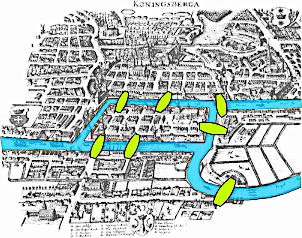{width=100%}
:::

::: {.column width="50%"}
Königsberg (aujourd'hui Kaliningrad), XVIII^e^ siècle : la Pregel, deux îles, **sept ponts**.

**Peut-on se promener en traversant chaque pont une et une seule fois ?**

::: fragment
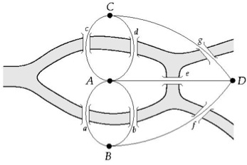{width=85%}

[Quatre terres (A, B, C, D), sept ponts : le premier **graphe**. Barabási, *Network Science*, chap. 2.]{.legende}
:::
:::
::::

## Le théorème d'Euler (1736)

- Ce qui compte n'est ni la longueur des ponts ni la forme des îles : seulement **qui est relié à qui**
- On entre dans une terre et on en ressort : un nœud traversé utilise ses liens **par paires**
- Seuls le **départ** et l'**arrivée** peuvent avoir un nombre **impair** de liens

::: fragment
- **Plus de deux** nœuds de degré impair : le chemin est **impossible**
- Graphe connexe, **zéro ou deux** nœuds de degré impair : le chemin **existe**
:::

::: fragment
::: remarque
À Königsberg, les **quatre** terres ont un nombre impair de ponts (5, 3, 3, 3). Euler l'a démontré sans marcher : en changeant de **représentation**.
:::
:::

## À vous : sans lever le crayon {.a-vous}

:::: columns
::: {.column width="45%"}
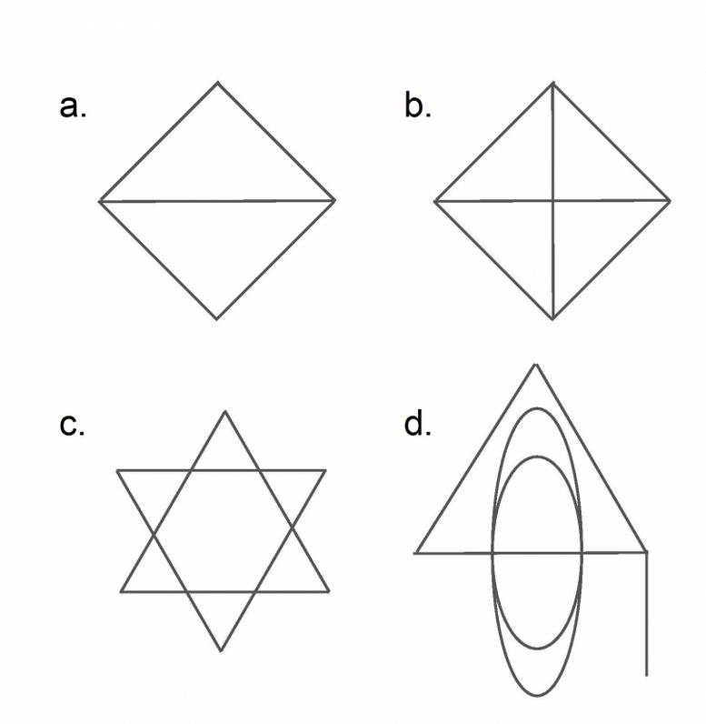{width=90%}
:::

::: {.column width="55%"}
Quelles figures peut-on dessiner **sans lever le crayon** et sans repasser deux fois sur un trait ? Pourquoi ?

::: fragment
- **a.** Oui : deux nœuds de degré **3** (les extrémités de la diagonale), deux de degré 2 ; on part d'une extrémité de la diagonale, on finit à l'autre
- **b.** Non : quatre coins de degré **3**, impairs
- **c.** Oui : tous les degrés sont pairs
- **d.** Oui : au plus **deux** nœuds impairs

On ne trace rien : on **compte les degrés**.
:::
:::
::::

## Plan

1. Introduction
2. Qu'est-ce qu'un réseau ?
3. Représenter un réseau dans R → **TP1**
4. Les réseaux en biologie
5. Propriétés topologiques
6. Modules et communautés → **TP2**

# Qu'est-ce qu'un réseau ? {.section-ul data-numero="2" background-color="#E30513"}

## Les éléments constitutifs

| | Français | Anglais | Notation |
|---|---|---|---|
| Les composants | **nœuds**, sommets | *nodes*, *vertices* | N |
| Les interactions | **liens**, arêtes | *links*, *edges* | L |
| Le système | **réseau**, graphe | *network*, *graph* | (N, L) |

::: fragment
::: remarque
« Réseau » désigne plutôt le système réel (des protéines qui interagissent), « graphe » sa représentation mathématique. igraph parle de *vertices* (`V()`) et d'*edges* (`E()`).
:::
:::

[Barabási, *Network Science* (2016), chap. 2 : <http://networksciencebook.com>.]{.legende}

## Dirigé ou non dirigé

```{r}
#| echo: false
#| fig-width: 10
#| fig-height: 3.6
#| out-width: "85%"
nd <- make_graph(c("A", "B", "B", "C", "C", "A", "C", "D"), directed = FALSE)
di <- make_graph(c("A", "B", "B", "C", "C", "A", "C", "D"), directed = TRUE)
par(mfrow = c(1, 2))
l <- layout_in_circle(nd)
dessine(nd, layout = l, vertex.size = 30, edge.width = 3, main = "")
dessine(di, layout = l, vertex.size = 30, edge.width = 3, edge.arrow.size = 1)
```

:::: columns
::: {.column width="50%"}
**Non dirigé** : le lien est **symétrique**

Interaction physique protéine-protéine, co-expression, co-apparition dans une scène
:::

::: {.column width="50%"}
**Dirigé** (*digraph*) : le lien a un **sens** (un arc)

Un facteur de transcription régule un gène, une réaction produit un métabolite, une page web cite une autre
:::
::::

## Pondéré, boucles, multigraphe

- **Pondéré** : chaque lien porte une valeur (nombre d'interactions, corrélation, score de confiance)
- **Boucle** (*self-loop*) : un nœud relié à lui-même (un gène qui régule sa propre expression)
- **Multigraphe** : plusieurs liens entre les mêmes nœuds (deux types d'interaction, ou la même interaction détectée deux fois)

::: fragment
::: remarque
Le **sens** d'un poids n'est pas écrit dans le graphe. 192 scènes partagées entre Ned et Robert : est-ce une **force** (proches) ou un **coût** (loin) ? R, lui, a son idée (section 5).
:::
:::

## Les réseaux bipartites

:::: columns
::: {.column width="55%"}
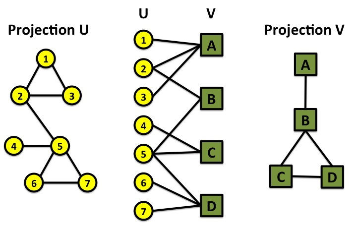{width=100%}
:::

::: {.column width="45%"}
Deux **types** de nœuds (U et V) ; chaque lien relie un nœud de U à un nœud de V, jamais deux nœuds du même type.

- gènes ↔ maladies
- métabolites ↔ réactions
- gènes ↔ termes GO

La **projection** sur V relie deux nœuds de V qui partagent un voisin dans U : on y **perd** de l'information.
:::
::::

## Un même graphe, plusieurs réseaux

:::: columns
::: {.column width="55%"}
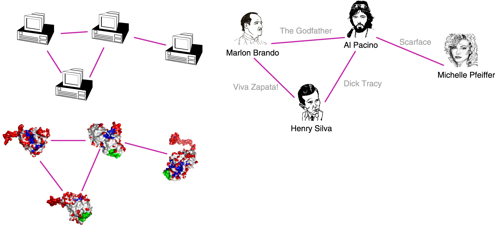{width=100%}
:::

::: {.column width="45%"}
N = 4, L = 4 : **le même graphe** pour

- des acteurs qui ont tourné ensemble
- des ordinateurs reliés par des câbles
- des protéines qui se lient

Les mêmes outils (degré, chemins, modules) s'appliquent partout. **L'interprétation**, elle, dépend du système.
:::
::::

[Barabási, *Network Science*, chap. 2.]{.legende}

## Choisir la bonne représentation

:::: columns
::: {.column width="55%"}
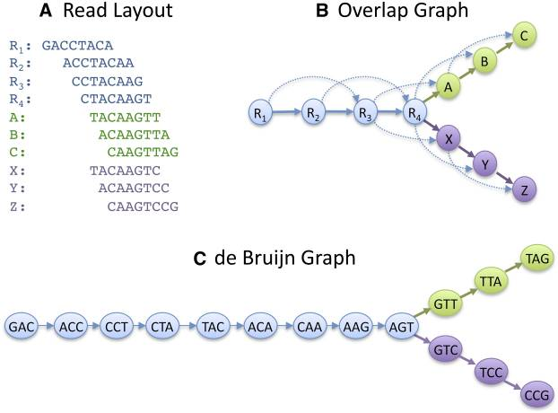{width=100%}
:::

::: {.column width="45%"}
Assembler un génome à partir de lectures :

- **graphe de chevauchement** : un nœud par lecture, un lien si deux lectures se chevauchent ; reconstruire = un chemin **hamiltonien** (difficile)
- **graphe de de Bruijn** : un nœud par *k*-mer, un lien par chevauchement de *k*−1 ; reconstruire = un chemin **eulérien** (facile)
:::
::::

::: fragment
::: remarque
Mêmes données, deux graphes, deux problèmes de difficulté très différente : c'est le pont de Königsberg qui fait tourner les assembleurs actuels (Compeau *et al.*, 2011).
:::
:::

## À vous : trouver un réseau {.a-vous}

Par deux, en 3 minutes : un **réseau réel** (biologique ou non).

1. Que représentent les **nœuds** ?
2. Que représentent les **liens** ?
3. Le graphe est-il **dirigé** ? **pondéré** ? Que signifie le poids ?
4. Y a-t-il des **boucles**, des liens **multiples**, deux **types** de nœuds ?

::: fragment
Exemples : réseau métabolique (dirigé, bipartite métabolites-réactions), co-auteurs (non dirigé, pondéré par le nombre d'articles), régulation génique (dirigé, boucles d'autorégulation), transport aérien (dirigé, pondéré par le nombre de vols), réseau trophique (dirigé : qui mange qui).
:::

# Représenter un réseau dans R {.section-ul data-numero="3" background-color="#E30513"}

```{r}
#| echo: false
#| output: asis
# Liste d'arêtes → matrice d'adjacence : trois diapos (liste, premier lien, matrice complète)
jouet <- tibble(from = c("A", "A", "B", "C"), to = c("B", "C", "C", "D"))
noms <- c("A", "B", "C", "D")
matrice_jouet <- function(k) {
  m <- matrix(0L, 4, 4, dimnames = list(noms, noms))
  for (i in seq_len(k)) { m[jouet$from[i], jouet$to[i]] <- 1L; m[jouet$to[i], jouet$from[i]] <- 1L }
  m
}
g_jouet <- graph_from_data_frame(jouet, directed = FALSE)
png("figure/anim/jouet.png", width = 4, height = 3.2, units = "in", res = 150)
dessine(g_jouet, layout = layout_in_circle(g_jouet), vertex.size = 34, vertex.label.cex = 1.6, edge.width = 3)
invisible(dev.off())
textes_adj <- c("Une **liste d'arêtes** : une ligne par lien. C'est la forme la plus courante dans un fichier.",
                "**Matrice d'adjacence** : A~ij~ = 1 s'il existe un lien entre i et j. Le lien A–B remplit **deux** cases : la matrice est **symétrique**.",
                "Les quatre liens : 8 cases à 1 sur 16. Diagonale nulle (pas de boucle). La **somme d'une ligne** est le **degré** du nœud.")
for (k in c(0, 1, 4)) {
  m <- as_tibble(matrice_jouet(k), rownames = " ")
  cases <- if (k == 0) NULL else which(as.matrix(m[, -1]) == 1L, arr.ind = TRUE)
  html_m <- tableau(m, cle = " ", cases_hl = if (is.null(cases)) NULL else cbind(cases[, 1], cases[, 2] + 1),
                    titre = "matrice d'adjacence", prefixe = "adj-")
  html_l <- tableau(jouet, cle = NULL, cles = 1:4, lignes_hl = seq_len(k), lignes_off = if (k %in% 1:3) (k + 1):4,
                    titre = "liste d'arêtes", prefixe = "lst-")
  bloc <- if (k == 0) rangee(html_l, fleche = FALSE) else rangee(html_l, html_m)
  cat(sprintf('\n\n## Deux façons d\'écrire un graphe {auto-animate=true auto-animate-id="adj"}\n\n%s\n\n:::: columns\n::: {.column width="68%%"}\n%s\n:::\n\n::: {.column width="32%%"}\n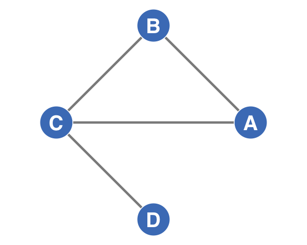{width=100%%}\n:::\n::::\n',
              textes_adj[which(c(0, 1, 4) == k)], bloc))
}
```

## Dirigé : une matrice non symétrique

```{r}
as_adjacency_matrix(g_jouet, sparse = FALSE)
g_dir <- graph_from_data_frame(jouet, directed = TRUE)
as_adjacency_matrix(g_dir, sparse = FALSE)
```

::: fragment
- Dirigé : A~ij~ = 1 s'il existe un lien **de** i **vers** j. La ligne donne les liens **sortants**, la colonne les **entrants**
- Pondéré : A~ij~ = le **poids** au lieu de 1
:::

## Les réseaux réels sont creux

:::: columns
::: {.column width="40%"}
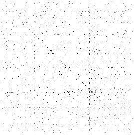{width=90%}

[Matrice d'adjacence du réseau d'interactions protéiques de la levure : un point par lien (Barabási, *Network Science*, chap. 2).]{.legende}
:::

::: {.column width="60%"}
- N nœuds : N(N−1)/2 liens **possibles** (non dirigé)
- **Densité** = L / [N(N−1)/2]
- 20 000 gènes : 200 millions de paires possibles, quelques centaines de milliers d'interactions connues

::: fragment
```{r}
edge_density(got)
```

Game of Thrones : `r ecount(got)` liens sur `r vcount(got) * (vcount(got) - 1) / 2` possibles. La matrice est remplie de **0** : on stocke plutôt la **liste** d'arêtes (ou une matrice *creuse*).
:::
:::
::::

## Les données du jour : Game of Thrones

```{r}
#| eval: false
got_aretes <- read_csv("/home/public/reseaux/got_edges.csv")
got_sexe   <- read_csv("/home/public/reseaux/got_sex.csv")
```

```{r}
got_aretes
```

::: legende
Saison 1 : deux personnages sont liés quand l'un parle juste après l'autre, parle de l'autre, quand un tiers parle des deux, quand ils sont nommés dans la même didascalie ou apparaissent dans la même scène. `weight` = nombre de fois. Données d'A. Beveridge (*Network of Thrones*), via le package `networkdata` (D. Schoch).
:::

## `graph_from_data_frame()`

```{r}
#| echo: false
#| results: asis
cat(code_annote(c("graph_from_data_frame(" = NA,
                  "got_aretes, " = "les 2 premières colonnes : les extrémités ; les autres : attributs des liens",
                  "directed = FALSE, " = "TRUE par défaut !",
                  "vertices = got_sexe" = "facultatif : un nœud par ligne, 1re colonne = le nom",
                  ")" = NA),
                c("gris", "bleu", "jaune", "vert", "gris")))
```

```{r}
got <- graph_from_data_frame(got_aretes, directed = FALSE, vertices = got_sexe)
got
```

## Lire l'en-tête d'un objet igraph

```{r}
#| echo: false
cat(capture.output(print(got))[1:2], sep = "\n")
```

| Code | Sens |
|---|---|
| `U` / `D` | **U**ndirected / **D**irected |
| `N` | les nœuds ont un attribut `name` (**N**amed) |
| `W` | les liens ont un attribut `weight` (**W**eighted) |
| `B` | **B**ipartite (ici `-` : non) |
| `127 550` | N = 127 nœuds, L = 550 liens |
| `name (v/c)` | attribut de **v**ertex, de type **c**aractère ; `(e/n)` : d'**e**dge, **n**umérique |

::: fragment
::: remarque
Première chose à lire après avoir construit un graphe : **U ou D**, et les **deux nombres**. Ils doivent correspondre à ce que vous attendiez.
:::
:::

## Nœuds, liens, attributs

```{r}
vcount(got); ecount(got)
V(got)[1:5]
E(got)[1:3]
V(got)$sex[1:5]
E(got)$weight[1:3]
```

::: fragment
- `V(g)$attribut <- valeurs` ajoute un attribut, dans **l'ordre de `V(g)`**
- `vertex_attr(g)`, `edge_attr(g)` : tous les attributs, sous forme de liste
- `as_data_frame(g, what = "vertices")` : retour au tableau (c'est la version d'**igraph**, qui masque celle de tibble)
:::

## Piège : dirigé par défaut

```{r}
g_d <- graph_from_data_frame(got_aretes)   # directed = TRUE par défaut
g_d
```

::: fragment
- Aucune erreur, aucun message : le graphe est **dirigé**, `from` → `to`
- Or l'ordre des colonnes ne veut rien dire ici : « Ned–Robert » n'a pas de sens
- Conséquences : `degree(mode = "in")` et `"out"` différents, chemins à sens unique, communautés différentes

```{r}
distances(g_d, "Robert", "Ned", mode = "out")
```

Robert ne « peut pas atteindre » Ned. Vérifier le **`U`/`D`** de l'en-tête.
:::

## Piège : les nœuds isolés disparaissent

Une liste d'arêtes ne connaît que les nœuds qui ont **au moins un lien**.

```{r}
aretes <- tibble(from = c("A", "B"), to = c("B", "C"))
noeuds <- tibble(name = c("A", "B", "C", "D"), type = c("x", "x", "y", "y"))
vcount(graph_from_data_frame(aretes, directed = FALSE))
vcount(graph_from_data_frame(aretes, directed = FALSE, vertices = noeuds))
```

::: fragment
- Sans `vertices`, **D** n'existe pas : un gène sans aucune corrélation au-dessus du seuil disparaît du réseau
- Avec `vertices`, tout nom des arêtes **absent** de `noeuds` donne une **erreur** (`Some vertex names in edge list are not listed in vertex data frame`) : c'est une bonne chose
- Compter les nœuds **avant** et **après**
:::

## Dessiner : `plot()`

```{r}
#| fig-height: 5
#| out-width: "62%"
set.seed(1)
plot(got, vertex.label = NA, vertex.size = 4,
     vertex.color = if_else(V(got)$sex == "F", "#E30513", "#4A7FC1"), edge.color = "grey80")
```

Options `vertex.*` (couleur, taille, étiquette) et `edge.*` (couleur, largeur, flèches) : `?igraph.plotting`.

## Les dispositions (*layouts*)

```{r}
#| fig-width: 12
#| fig-height: 3.4
#| out-width: "100%"
par(mfrow = c(1, 4), mar = c(0, 0, 1.5, 0))
for (f in c("layout_randomly", "layout_in_circle", "layout_with_fr", "layout_with_kk")) {
  plot(sw, layout = get(f), vertex.label = NA, vertex.size = 8, vertex.color = "#4A7FC1", main = f)
}
```

- Une disposition = un algorithme qui donne des **coordonnées** à chaque nœud
- `layout_with_fr` (Fruchterman-Reingold), `layout_with_kk` : les liens tirent, les nœuds se repoussent
- **Le même graphe**, quatre images : la position n'est **pas** une donnée

## Piège : une image différente à chaque fois

```{r}
#| fig-width: 12
#| fig-height: 3.4
#| out-width: "100%"
par(mfrow = c(1, 4), mar = c(0, 0, 1.5, 0))
for (i in 1:4) plot(sw, layout = layout_with_fr, vertex.label = NA, vertex.size = 8, vertex.color = "#4A7FC1", main = i)
```

::: fragment
- Les algorithmes de disposition partent d'une position **aléatoire** : `set.seed()`, ou calculer `l <- layout_with_fr(g)` **une fois** et le réutiliser
- Deux nœuds **proches à l'écran** ne sont pas forcément liés ; un nœud **au centre** n'est pas forcément central
- Une figure de réseau **illustre** ; les conclusions viennent des **calculs** (section 5)
:::

## À vous : lire un objet igraph {.a-vous}

```{r}
#| eval: false
aretes <- tibble(from = c("TF1", "TF1", "TF2", "TF2", "geneA"),
                 to   = c("geneA", "geneB", "geneB", "TF2", "TF1"),
                 effet = c(1, -1, 1, 1, -1))
g <- graph_from_data_frame(aretes)
g
```

1. Que contient la première ligne de `g` (lettres et nombres) ?
2. `degree(g, "TF2")` ? Et `degree(g, "TF2", mode = "out")` ?
3. Quelle ligne de `aretes` est une boucle ? Que dit-elle en biologie ?

::: fragment
1. `DN--` : **dirigé** (défaut), nommé ; pas de `W` car l'attribut s'appelle `effet`, pas `weight`. **4 nœuds, 5 liens**
2. Sortants : TF2→geneB et TF2→TF2, soit **2** ; entrant : la boucle seule, **1**. `degree()` additionne les deux : **3** (la boucle compte deux fois)
3. `TF2 → TF2` : une **autorégulation** (le facteur active son propre gène)
:::

# TP1 {.section-ul background-color="#E30513"}

# Les réseaux en biologie {.section-ul data-numero="4" background-color="#E30513"}

## Un panorama

| Réseau | Nœuds | Liens | Dirigé ? | D'où viennent les liens ? |
|---|---|---|---|---|
| **Interactions protéiques** (PPI) | protéines | liaison physique | non | double-hybride, co-IP, prédictions |
| **Régulation** | facteurs, gènes | régulation | **oui** | ChIP-seq, perturbations, inférence |
| **Métabolique** | métabolites, réactions | conversion | **oui** | biochimie, génomes annotés |
| **Co-expression** | gènes | corrélation | non | données d'expression, **calculé** |
| **Maladies** | gènes, maladies | association | non, bipartite | génétique, littérature |

::: fragment
::: remarque
Certains liens sont **mesurés**, d'autres **prédits**, d'autres **calculés** à partir de vos données. Même question qu'au module bases de données : d'où vient le lien, et que vaut-il ?
:::
:::

## Les interactions protéine-protéine

:::: columns
::: {.column width="45%"}
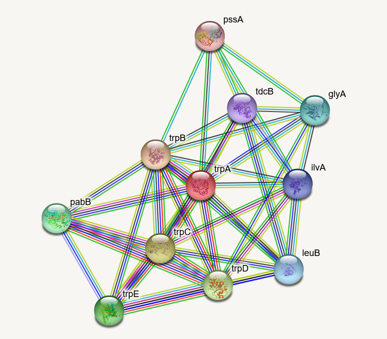{width=95%}

[STRING : une couleur de lien par type de preuve.]{.legende}
:::

::: {.column width="55%"}
**Expérimentales**

- **double-hybride** chez la levure (*yeast two-hybrid*) : deux protéines qui se lient reconstituent un facteur de transcription
- **co-immunoprécipitation** + spectrométrie de masse : des **complexes**
- ChIP : protéine-ADN

**Prédites**

- contexte génomique (fusion de domaines, voisinage conservé, profils phylogénétiques), co-expression, **fouille de texte**

STRING combine le tout en un **score de confiance** (0 à 1) : <https://string-db.org>
:::
::::

## Les réseaux métaboliques

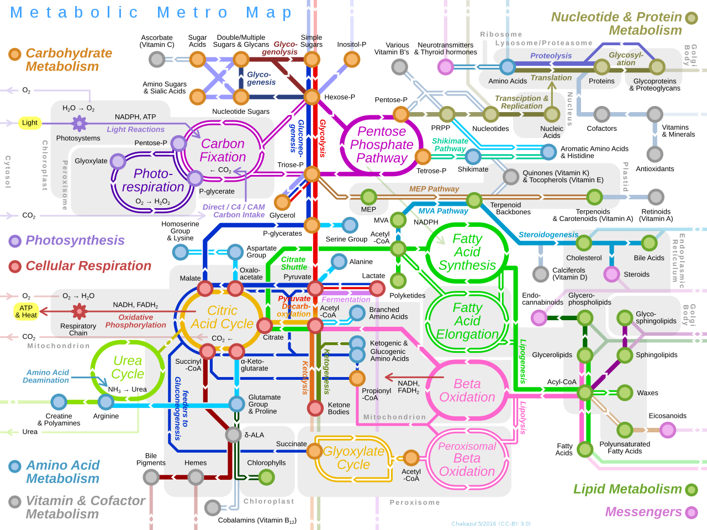{width=72%}

[Le métabolisme en plan de métro (Wikimedia Commons, *Metabolic Metro Map*). Bases : KEGG, Reactome, MetaCyc.]{.legende}

Dirigés, souvent **bipartites** (métabolites ↔ réactions). Les métabolites très partagés (ATP, H~2~O, NADH) relient tout à tout : on les retire souvent avant d'analyser.

## Les réseaux de co-expression

Deux gènes sont liés si leurs expressions **varient ensemble** d'un échantillon à l'autre.

1. Une matrice d'expression : gènes × échantillons
2. Une **corrélation** pour chaque paire de gènes
3. Un **seuil** (ou une transformation en puissance, comme WGCNA) : corrélation → lien
4. Un graphe : on y cherche des **modules** et des **hubs**

::: fragment
::: remarque
Contrairement à une PPI, ce réseau est **calculé à partir de vos données** : chaque choix (gènes retenus, corrélation, seuil) change le graphe. Et une corrélation n'est ni une interaction ni une régulation.
:::
:::

## Les données : `airway`, encore

```{r}
#| eval: false
coexpr <- read_tsv("/home/public/reseaux/airway_coexpr.tsv")
```

```{r}
coexpr |> dplyr::select(1:6)
```

- Les **150 gènes les plus variables** d'`airway` (expression stabilisée `vst` de DESeq2), 8 échantillons nommés `donneur_traitement`
- `statut` : induit, réprimé ou non DE par la dexaméthasone (`padj` < 0.05, |log2FC| > 1)
- `chromosome` : on en aura besoin…

```{r}
#| echo: false
#| output: asis
# De l'expression au graphe : quatre diapos (expression, corrélations, seuil, graphe)
genes_jouet <- c("FKBP5", "TSC22D3", "VCAM1", "RPS4Y1")
m_jouet <- coexpr |> filter(symbole %in% genes_jouet) |>
  dplyr::select(symbole, ends_with("trt")) |>
  column_to_rownames("symbole") |> as.matrix()
m_jouet <- m_jouet[genes_jouet, ]
r_jouet <- cor(t(m_jouet))
expr_tab <- as_tibble(round(m_jouet, 1), rownames = "gène")
names(expr_tab) <- c("gène", paste0("D", rep(1:4, each = 2), c("−", "+")))  # donneur 1 à 4, non traité (−) / traité (+)
cor_tab <- as_tibble(round(r_jouet, 2), rownames = "gène")
adj_jouet <- (r_jouet > 0.8) * 1L; diag(adj_jouet) <- 0L
adj_tab <- as_tibble(adj_jouet, rownames = "gène")
forts <- which(r_jouet > 0.8 & row(r_jouet) != col(r_jouet), arr.ind = TRUE)
g_coj <- graph_from_adjacency_matrix(adj_jouet, mode = "undirected")
png("figure/anim/coexpr_jouet.png", width = 4.2, height = 3.4, units = "in", res = 150)
dessine(g_coj, layout = layout_in_circle(g_coj), vertex.size = 52, vertex.label.cex = 0.7, edge.width = 4, margin = 0.15)
invisible(dev.off())
diapo_co <- function(texte, contenu) cat(sprintf('\n\n## De l\'expression au graphe {auto-animate=true auto-animate-id="coexpr"}\n\n%s\n\n%s\n', texte, contenu))
diapo_co("Quatre gènes, huit échantillons : quatre donneurs (D1 à D4), non traités (−) et traités (+) ; expression `vst`.", rangee(tableau(expr_tab, cle = "gène", titre = "expression")))
diapo_co(sprintf("Une corrélation de Pearson par paire : `cor(t(m))`. *FKBP5* et *TSC22D3* montent ensemble (r = %.2f) ; *VCAM1* varie **en sens inverse** (r = %.2f avec *FKBP5*).",
                 r_jouet["FKBP5", "TSC22D3"], r_jouet["FKBP5", "VCAM1"]),
         rangee(tableau(cor_tab, cle = "gène", cases_hl = cbind(forts[, 1], forts[, 2] + 1), titre = "corrélations", prefixe = "c-")))
diapo_co("Un **seuil** : r > 0.8 → 1, sinon 0. La diagonale est mise à 0 (pas de boucle).",
         rangee(tableau(cor_tab, cle = "gène", cases_hl = cbind(forts[, 1], forts[, 2] + 1), titre = "corrélations", prefixe = "c-"),
                tableau(adj_tab, cle = "gène", cases_hl = cbind(forts[, 1], forts[, 2] + 1), titre = "adjacence", prefixe = "a-")))
diapo_co("`graph_from_adjacency_matrix(adj, mode = \"undirected\")` : **un seul lien**. *VCAM1* (anticorrélé) et *RPS4Y1* (chromosome Y) restent **isolés**.",
         sprintf(':::: columns\n::: {.column width="55%%"}\n%s\n:::\n\n::: {.column width="45%%"}\n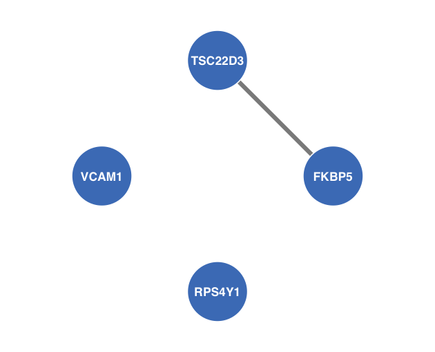{width=100%%}\n:::\n::::',
                 rangee(tableau(adj_tab, cle = "gène", cases_hl = cbind(forts[, 1], forts[, 2] + 1), titre = "adjacence", prefixe = "a-"))))
```

## Le réseau complet

```{r}
m <- coexpr |> dplyr::select(symbole, contains("_")) |> column_to_rownames("symbole") |> as.matrix()
r <- cor(t(m))                      # 150 × 150 corrélations
adj <- (r > 0.8) * 1; diag(adj) <- 0
g_co <- graph_from_adjacency_matrix(adj, mode = "undirected")
V(g_co)$statut <- coexpr$statut      # même ordre que les lignes de m
g_co
```

::: fragment
`r vcount(g_co)` gènes, `r ecount(g_co)` liens, densité `r round(edge_density(g_co), 3)`, `r sum(degree(g_co) == 0)` gènes isolés. Le `contains("_")` ne garde que les 8 colonnes d'échantillons.
:::

## Le problème de l'inférence

:::: columns
::: {.column width="55%"}
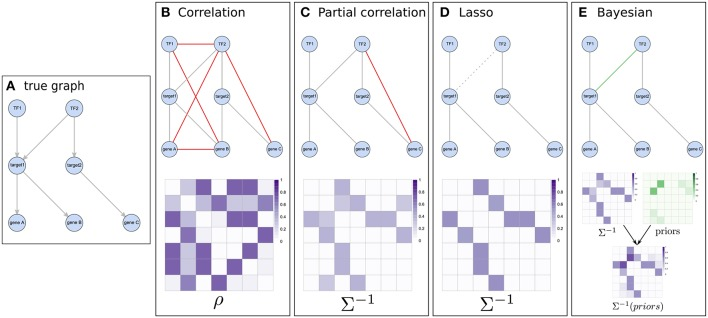{width=100%}

[Un même vrai réseau (A), quatre méthodes d'inférence, quatre graphes différents.]{.legende}
:::

::: {.column width="45%"}
- Corrélation **marginale** : A et C corrélés parce que tous deux régulés par B ; un lien **indirect**
- Corrélation **partielle**, lasso, réseaux bayésiens : tentent de retirer les liens indirects
- Aucune méthode ne retrouve bien le vrai réseau à partir de l'expression seule (défi DREAM5, Marbach *et al.*, 2012)
:::
::::

## Piège : 8 échantillons

Avec 8 échantillons, de **fortes corrélations apparaissent par hasard**.

```{r}
set.seed(1)
bruit <- matrix(rnorm(150 * 8), nrow = 150)   # 150 « gènes » sans aucun lien réel
r_bruit <- cor(t(bruit))
sum(r_bruit[upper.tri(r_bruit)] > 0.8)
```

::: fragment
- `r sum(r_bruit[upper.tri(r_bruit)] > 0.8)` liens « r > 0.8 » entre gènes **indépendants**, sur `r format(choose(150, 2), big.mark = " ")` paires
- Avec n = 8, une corrélation fluctue énormément : il faut de **nombreux** échantillons (WGCNA recommande au moins une quinzaine à une vingtaine)
- Ici, ce qui sauve `airway` : un **traitement** et des **donneurs** qui structurent fortement l'expression
:::

## Ce qu'on fait d'un réseau de co-expression

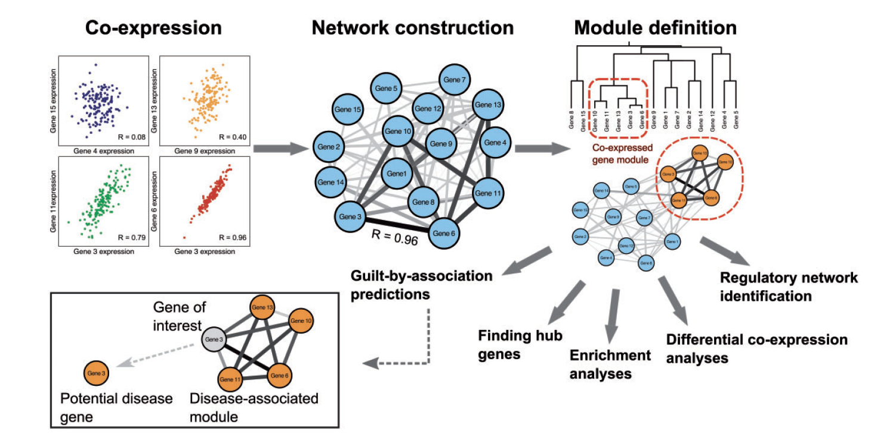{width=85%}

- **Modules** de gènes co-exprimés, reliés à un phénotype
- **Culpabilité par association** (*guilt by association*) : un gène inconnu dans un module de gènes de la réponse immunitaire y participe probablement
- **Hubs** : candidats régulateurs ou biomarqueurs

[van Dam *et al.* (2018), *Briefings in Bioinformatics*.]{.legende}

## Le réseau des maladies humaines

:::: columns
::: {.column width="45%"}
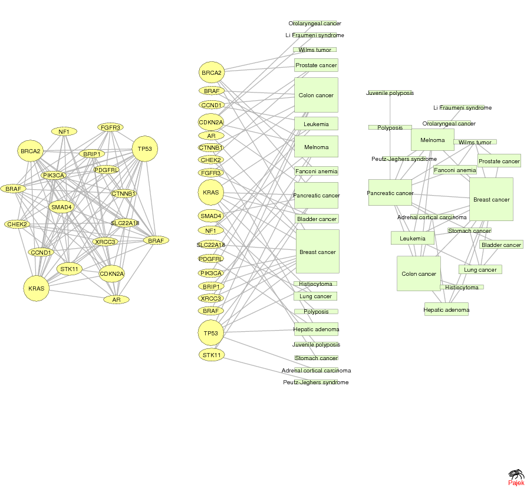{width=100%}
:::

::: {.column width="55%"}
Goh *et al.* (2007) : un graphe **bipartite** gènes ↔ maladies (OMIM), et ses deux **projections** :

- **réseau des maladies** : deux maladies liées si elles partagent un gène
- **réseau des gènes** : deux gènes liés s'ils sont associés à la même maladie

Les gènes d'une même maladie interagissent plus souvent entre eux qu'au hasard : des **modules de maladie**.
:::
::::

[Goh *et al.* (2007), *PNAS*.]{.legende}

# Propriétés topologiques {.section-ul data-numero="5" background-color="#E30513"}

## Le degré

Le **degré** k~i~ d'un nœud : son nombre de liens.

```{r}
sort(degree(got), decreasing = TRUE)[1:6]
```

::: fragment
- Dirigé : degré **entrant** (`mode = "in"`) + degré **sortant** (`"out"`) = degré total
- Pondéré : la **force** (*strength*) = somme des poids

```{r}
sort(strength(got), decreasing = TRUE)[1:6]
```
:::

## Le degré n'est qu'un `count()`

```{r}
#| echo: false
#| output: asis
# Degré = nombre d'apparitions d'un nœud dans la liste d'arêtes : trois diapos (liste, format long, count)
long <- jouet |> mutate(lien = row_number()) |> pivot_longer(c(from, to), names_to = "extrémité", values_to = "nœud")
deg <- long |> dplyr::count(nœud, name = "degré")
ids_long <- cbind(paste0("l", long$lien), paste0("e", seq_len(nrow(long))), paste0("n", seq_len(nrow(long))))
txt <- c("La liste d'arêtes du graphe jouet.",
         "`pivot_longer(c(from, to))` : une ligne par **extrémité** de lien.",
         "`count(nœud)` : le nombre d'apparitions de chaque nœud. C'est **exactement** `degree()`.")
for (e in 1:3) {
  html <- switch(e,
    rangee(tableau(jouet, cle = NULL, cles = 1:4, titre = "arêtes")),
    rangee(tableau(jouet, cle = NULL, cles = 1:4, titre = "arêtes"), tableau(long, cle = NULL, ids = ids_long, cols_hl = "nœud", titre = "format long")),
    rangee(tableau(long, cle = NULL, ids = ids_long, cols_hl = "nœud", titre = "format long"), tableau(deg, cle = "nœud", cols_new = "degré", titre = "degré", prefixe = "d-")))
  cat(sprintf('\n\n## Le degré n\'est qu\'un `count()` {auto-animate=true auto-animate-id="degre"}\n\n%s\n\n%s\n', txt[e], html))
}
cat('\n\n```r\ndegree(g_jouet)\n```\n\n```\n', paste(capture.output(degree(g_jouet)), collapse = "\n"), '\n```\n')
```

## La distribution des degrés

```{r}
#| fig-height: 3.6
tibble(k = degree(got)) |>
  ggplot(aes(k)) + geom_histogram(binwidth = 2, fill = "#4A7FC1") +
  labs(x = "degré k", y = "nombre de personnages")
```

P(k) = N~k~ / N : la probabilité qu'un nœud pris au hasard ait le degré k. Beaucoup de personnages avec **peu** de liens, quelques-uns avec **beaucoup** : `r sum(degree(got) <= 3)` personnages ont au plus 3 liens, Ned en a `r degree(got, "Ned")`.

## Réseaux aléatoires et invariants d'échelle

:::: columns
::: {.column width="55%"}
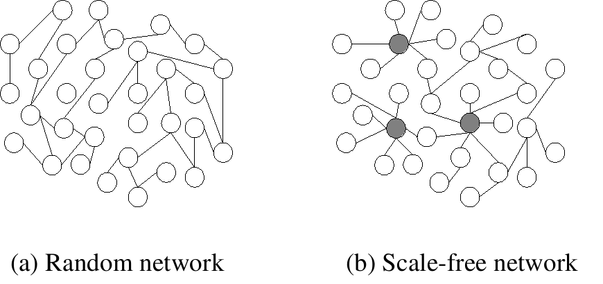{width=100%}

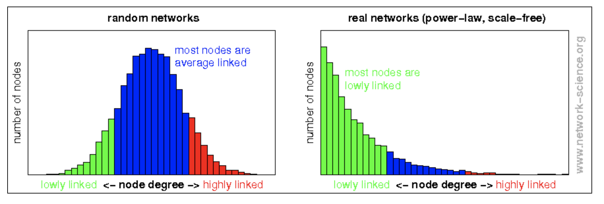{width=100%}
:::

::: {.column width="45%"}
- **Aléatoire** (Erdős-Rényi) : chaque paire liée avec la même probabilité ; degrés **groupés** autour de la moyenne, pas de hub
- **Invariant d'échelle** (*scale-free*) : P(k) ~ k^−γ^, une **loi de puissance** ; beaucoup de nœuds peu liés, quelques **hubs** très liés
- Barabási et Albert (1999) : la **croissance** plus l'**attachement préférentiel** (les riches s'enrichissent) produisent une loi de puissance
:::
::::

## Les hubs

:::: columns
::: {.column width="50%"}
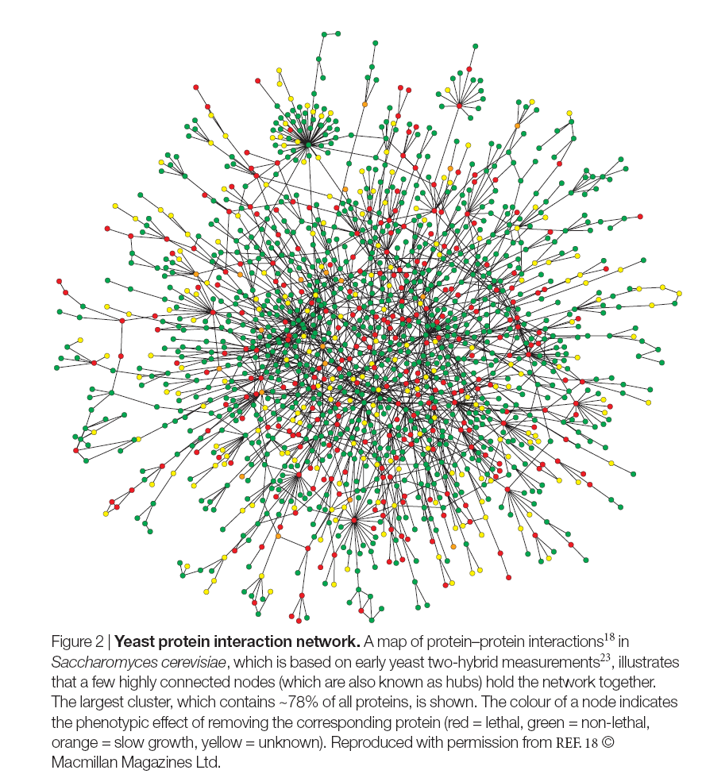{width=92%}
:::

::: {.column width="50%"}
Réseau d'interactions protéiques de *S. cerevisiae* (Jeong *et al.*, 2001). Couleur = effet de la délétion du gène :

- **rouge** : létal ; **vert** : non létal
- **orange** : croissance lente ; **jaune** : inconnu

Les protéines les plus connectées sont plus souvent **essentielles** : la règle « centralité-létalité ».

Un réseau invariant d'échelle **résiste** aux pannes au hasard, mais est **fragile** face à une attaque ciblée des hubs.
:::
::::

## Nuancer : des hubs… ou des gènes très étudiés ?

- Une protéine **célèbre** (TP53, BRCA1) est testée dans plus d'expériences : elle a plus d'interactions **connues**, pas forcément plus d'interactions **réelles**
- Le double-hybride et la co-IP ont leurs biais (faux positifs, protéines membranaires mal détectées)
- Broido et Clauset (2019), sur près de 1 000 réseaux réels : les lois de puissance **strictes** sont **rares** ; « queue lourde » est plus juste

::: fragment
::: remarque
Le même biais qu'au module bases de données : les gènes déjà étudiés sont les mieux annotés. Un hub d'un réseau **issu de la littérature** est d'abord un gène **beaucoup publié**.
:::
:::

## Chemins et distances

- **Chemin** : une suite de nœuds où chacun est lié au suivant
- **Distance** (plus court chemin, géodésique) : le nombre de liens du chemin le plus court ; **infinie** si les nœuds sont dans deux composantes séparées
- Dirigé : on suit le **sens** des flèches, la distance de A à B peut différer de celle de B à A
- **Diamètre** : la plus grande distance ; **longueur moyenne** des plus courts chemins

```{r}
shortest_paths(sw, from = "LUKE", to = "DARTH VADER", weights = NA)$vpath
diameter(sw, weights = NA); mean_distance(sw, weights = NA)
```

## Piège : les poids sont des distances

```{r}
diameter(got, weights = NA)    # en nombre de liens
diameter(got)                  # avec E(got)$weight, utilisé automatiquement
```

::: fragment
- Dès qu'un attribut s'appelle `weight`, `distances()`, `shortest_paths()`, `diameter()`, `betweenness()`… l'utilisent comme une **longueur**
- Ici le poids est un nombre d'interactions : **plus** il est grand, plus les personnages sont **proches**. igraph le lit à l'envers

```{r}
shortest_paths(got, "Jon", "Daenerys", weights = NA)$vpath[[1]]
shortest_paths(got, "Jon", "Daenerys")$vpath[[1]]
```

Le « plus court » chemin pondéré **évite** Ned, le personnage le plus lié aux deux. `weights = NA` (ignorer), ou une vraie distance : `1 / weight`.
:::

## La centralité d'intermédiarité

:::: columns
::: {.column width="45%"}
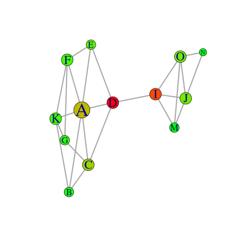{width=70%}

[Les nœuds rouges relient deux groupes : faible degré, forte intermédiarité.]{.legende}
:::

::: {.column width="55%"}
*Betweenness* : le nombre de plus courts chemins qui **passent par** un nœud. Un nœud **pont** entre deux modules, même avec peu de liens.

```{r}
sort(betweenness(got, weights = NA), decreasing = TRUE)[1:5]
sort(betweenness(got), decreasing = TRUE)[1:5]
```

Avec les poids lus comme des distances, Jorah, Aerys et Catelyn passent devant Tyrion : un classement **faux** sans aucun message.
:::
::::

## Le coefficient de *clustering*

:::: columns
::: {.column width="50%"}
Pour un nœud i de degré k~i~ : quelle proportion de ses voisins sont **liés entre eux** ?

$$C_i = \frac{2 e_i}{k_i (k_i - 1)}$$

e~i~ = nombre de liens entre les voisins de i ; C~i~ ∈ [0, 1].

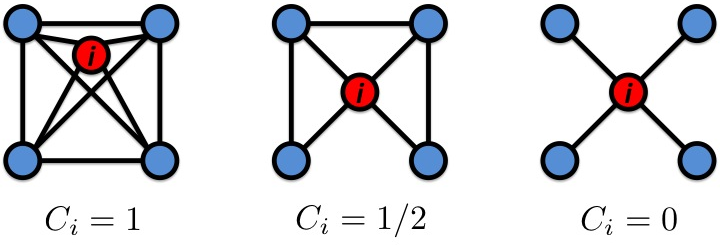{width=90%}
:::

::: {.column width="50%"}
« Les amis de mes amis sont mes amis. »

```{r}
transitivity(got, type = "global")
transitivity(got, type = "local", vids = c("Ned", "Jon", "Drogo"))
```

Un réseau aléatoire de même densité aurait C ≈ `r round(edge_density(got), 2)`.
:::
::::

## Le petit monde

- **Courtes distances** : distance moyenne `r round(mean_distance(got, weights = NA), 2)` dans Game of Thrones, `r round(mean_distance(sw, weights = NA), 2)` dans Star Wars
- **Fort *clustering*** : `r round(transitivity(got), 2)` contre `r round(edge_density(got), 2)` attendu au hasard
- Watts et Strogatz (1998) : quelques liens « raccourcis » dans un réseau très local suffisent à rapprocher tout le monde

::: fragment
::: remarque
Biologie : un signal ou une perturbation atteint presque toute la cellule en quelques étapes ; les « six degrés de séparation » des réseaux sociaux.
:::
:::

## Connexité et composantes

```{r}
components(g_co)$no
sort(components(g_co)$csize, decreasing = TRUE)
```

- Une **composante** : un ensemble de nœuds tous reliés par des chemins
- Entre deux composantes, la distance est **infinie** (`Inf`) : `mean_distance()` ignore ces paires sans le dire

::: fragment
::: remarque
`components()` existe aussi dans le package `generics`, que charge Bioconductor : chargé après igraph (par exemple `library(DESeq2)`), il la **masque** (`no applicable method for 'components'`). Écrire `igraph::components()`.
:::
:::

## À vous : prédire des descripteurs {.a-vous}

```{r}
#| echo: false
#| fig-width: 5
#| fig-height: 2.4
#| out-width: "45%"
ex <- make_graph(~ A - B, A - C, B - C, C - D, D - E)
dessine(ex, layout = cbind(c(0, 0, 1, 2, 3), c(1, -1, 0, 0, 0)), vertex.size = 22, vertex.label.cex = 1.4, edge.width = 3)
```

1. Le degré de chaque nœud ? La densité ?
2. La distance de A à E ? Le diamètre ?
3. Le *clustering* local de C ?
4. Quel nœud a la plus forte intermédiarité ?

::: fragment
1. A 2, B 2, C **3**, D 2, E 1 ; densité = 5 / 10 = **0,5**
2. A–C–D–E : **3** ; diamètre **3** (A ou B à E)
3. Voisins de C : A, B, D ; un seul lien entre eux (A–B) sur 3 possibles : **1/3**
4. **C** (`r betweenness(ex)["C"]` chemins passent par lui), puis D (`r betweenness(ex)["D"]`)
:::

# Modules et communautés {.section-ul data-numero="6" background-color="#E30513"}

## Les cliques

Une **clique** : un sous-graphe **complet**, où chaque nœud est lié à tous les autres.

```{r}
clique_num(got)
largest_cliques(got)[[1]]
length(largest_cliques(got))
```

::: fragment
- `r length(largest_cliques(got))` cliques de taille `r clique_num(got)`, qui se **chevauchent** : une notion trop stricte (un seul lien manquant suffit à casser la clique)
- Biologie : un complexe protéique où tout le monde se touche
:::

## La modularité

:::: columns
::: {.column width="45%"}
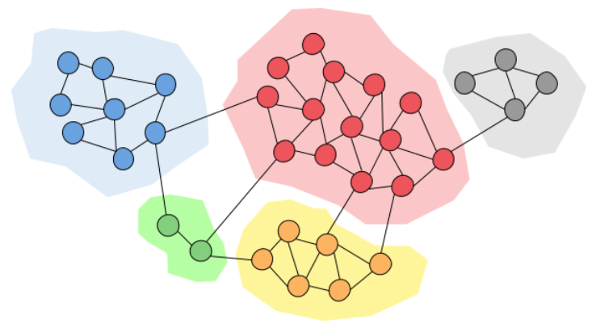{width=100%}
:::

::: {.column width="55%"}
Un **module** (communauté) : beaucoup de liens **à l'intérieur**, peu **vers l'extérieur**.

**Modularité** Q (Newman et Girvan, 2004) : la fraction des liens internes aux modules, **moins** celle attendue au hasard (degrés conservés). Q > 0,3 : structure nette.

- **Agglomératives** : chaque nœud seul au départ, on fusionne (Louvain, Blondel *et al.*, 2008)
- **Divisives** : tout ensemble, on coupe les liens les plus « intermédiaires » (Girvan-Newman)
- **Marches aléatoires** : un marcheur reste piégé dans son module (walktrap)
:::
::::

## Détecter des communautés dans R

```{r}
#| fig-height: 4.6
#| out-width: "55%"
set.seed(1)
comm <- cluster_louvain(sw)
membership(comm)[c("LUKE", "LEIA", "DARTH VADER", "TARKIN", "BERU", "OWEN")]
sizes(comm); modularity(comm)
par(mar = c(0, 0, 0, 0)); plot(comm, sw, vertex.label.cex = 0.7, vertex.size = 8)
```

## Les modules de co-expression

```{r}
set.seed(1)
modules <- cluster_louvain(g_co)
V(g_co)$module <- membership(modules)
tibble(module = V(g_co)$module, statut = V(g_co)$statut, chr = coexpr$chromosome) |>
  dplyr::count(module, statut) |>
  pivot_wider(names_from = statut, values_from = n, values_fill = 0) |>
  filter(induit + `non DE` + réprimé > 2)
```

```{r}
#| echo: false
tab_mod <- tibble(module = V(g_co)$module, chr = coexpr$chromosome, sym = coexpr$symbole)
mod_y <- tab_mod |> filter(chr == "Y") |> dplyr::count(module) |> slice_max(n, n = 1) |> pull(module)
```

::: fragment
Des modules **purs** : induits d'un côté, réprimés de l'autre. Et le module `r mod_y`, **non DE** : `r paste0("*", tab_mod$sym[tab_mod$module == mod_y], "*", collapse = ", ")`. Que se passe-t-il ?
:::

## Un module… le sexe du donneur

```{r}
coexpr |> filter(symbole %in% c("RPS4Y1", "DDX3Y", "XIST")) |> dplyr::select(symbole, contains("_"))
```

::: fragment
- Les gènes du **chromosome Y** sont éteints chez le donneur N061011, qui exprime *XIST* : c'est une **donneuse**
- Un module parfaitement « réel » et cohérent… qui n'a **rien à voir** avec la dexaméthasone
- *XIST*, **anticorrélé**, n'est pas dans ce module : nous n'avons gardé que les corrélations **positives**
:::

::: fragment
::: remarque
Un module dit : « ces gènes varient ensemble **dans ces échantillons** ». Le pourquoi (traitement, donneur, sexe, lot de séquençage) est à **chercher**, par exemple par une analyse d'enrichissement.
:::
:::

## Piège : le seuil

```{r}
seuils <- c(0.7, 0.8, 0.9)
map_dfr(seuils, function(s) {
  a <- (r > s) * 1; diag(a) <- 0
  g <- graph_from_adjacency_matrix(a, mode = "undirected")
  set.seed(1)
  tibble(seuil = s, liens = ecount(g), isolés = sum(degree(g) == 0),
         composantes = igraph::components(g)$no, modules = length(cluster_louvain(g)))
})
```

::: fragment
Le seuil est un **choix**, pas un résultat : il fait varier le nombre de liens, d'isolés, de modules. Montrer que la conclusion **résiste** à plusieurs seuils. WGCNA remplace le seuil par une puissance (r^β^) choisie pour approcher une loi de puissance (Langfelder et Horvath, 2008).
:::

## Piège : la valeur absolue

```{r}
adj_abs <- (abs(r) > 0.8) * 1; diag(adj_abs) <- 0
g_abs <- graph_from_adjacency_matrix(adj_abs, mode = "undirected")
set.seed(1)
table(module = membership(cluster_louvain(g_abs)), coexpr$statut)
```

::: fragment
- Avec `abs(r)`, deux gènes **anticorrélés** sont liés : induits et réprimés tombent dans les **mêmes** modules
- Parfois voulu (un régulateur et sa cible réprimée), mais il faut le **savoir** : réseau **signé** ou **non signé**
- Même erreur que mélanger induits et réprimés dans une ORA
:::

## Piège : Louvain n'est pas déterministe

```{r}
tailles <- map(1:5, function(graine) { set.seed(graine); sort(sizes(cluster_louvain(got)), decreasing = TRUE) })
map_chr(tailles, \(t) paste(t, collapse = " "))
```

::: fragment
- L'algorithme parcourt les nœuds dans un ordre **aléatoire** : la partition peut changer d'une exécution à l'autre
- `set.seed()` pour reproduire ; comparer plusieurs graines pour juger la **stabilité** ; méthodes plus récentes : Leiden (Traag *et al.*, 2019)
- Les numéros de modules sont des **étiquettes** : le module 1 d'une exécution n'est pas le module 1 de la suivante
:::

## Au-delà : propagation et multi-omique

:::: columns
::: {.column width="50%"}
**Propagation sur le réseau** : partir de gènes connus (graines) et diffuser par **marche aléatoire** ; on classe les autres nœuds selon leur proximité. Mieux que les voisins directs (faux négatifs) ou les plus courts chemins (faux positifs).

**Réseaux multicouches** : PPI + régulation + métabolisme + co-expression, reliés entre eux (OmicsNet, <https://www.omicsnet.ca>).
:::

::: {.column width="50%"}
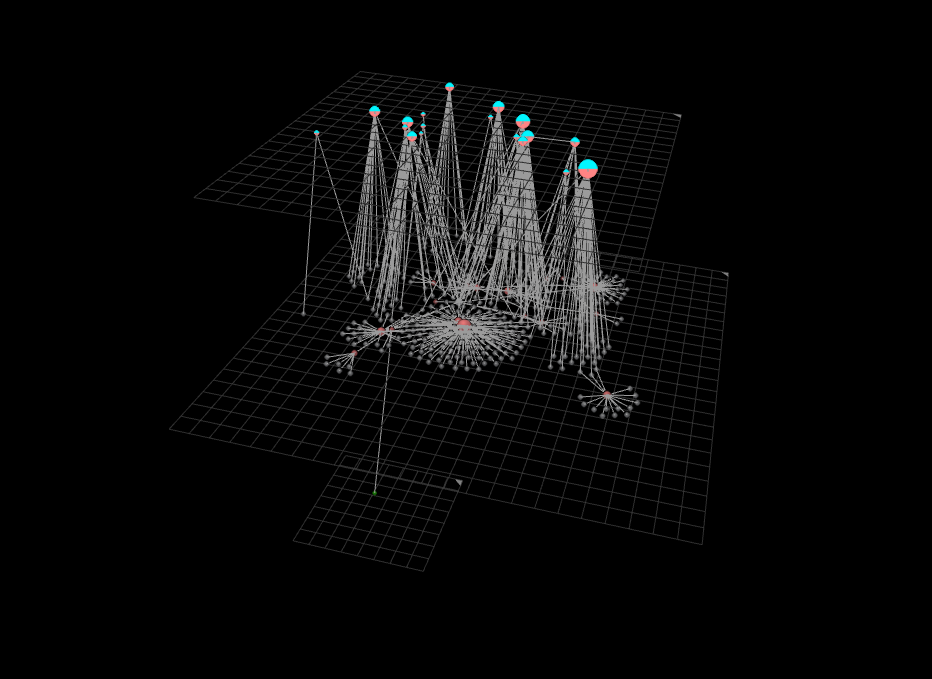{width=100%}
:::
::::

## Ce qu'on retient des réseaux biologiques

| Propriété | Ce que cela veut dire |
|---|---|
| **Creux** | peu de liens parmi tous les possibles |
| **Queue lourde** | beaucoup de nœuds peu liés, quelques hubs |
| **Petit monde** | courtes distances et fort *clustering* |
| **Modulaire** | des modules fonctionnels, interprétables par enrichissement |
| **Robuste** | résiste aux pannes au hasard, fragile aux attaques des hubs |
| **Dirigé, hiérarchique** | cascades de régulation et de signalisation |
| **Multicouche** | plusieurs types de liens, plusieurs types de nœuds |

## À vous : lire une analyse de réseau {.a-vous}

Un étudiant construit un réseau de co-expression sur 6 échantillons, avec `abs(cor) > 0.7`, puis écrit :

```{r}
#| eval: false
g <- graph_from_data_frame(liens)          # liens : gene1, gene2, weight = |r|
hub <- names(which.max(betweenness(g)))
```

> « Le gène `hub` est le régulateur central de la réponse au traitement. »

1. Trois problèmes dans le code.
2. Deux objections à la conclusion.

::: fragment
1. Graphe **dirigé** par défaut ; `weight` = |r| lu comme une **distance** (les gènes les plus corrélés sont les plus « loin ») ; `abs()` mélange corrélations positives et **négatives**
2. 6 échantillons : beaucoup de corrélations **dues au hasard**, et le résultat dépend du **seuil** ; une corrélation n'est pas une **régulation** (pas de sens, pas de causalité). Le « hub » peut refléter un donneur, le sexe ou un lot
:::

# TP2 {.section-ul background-color="#E30513"}

## Conclusion

- Un **graphe** : des nœuds, des liens, dirigés ou non, pondérés ou non ; choisir la **représentation** est déjà résoudre le problème (Euler, de Bruijn)
- Dans R : `graph_from_data_frame()` (**dirigé par défaut**), `graph_from_adjacency_matrix()` ; lire l'en-tête `U`/`D`, N et L
- Les liens biologiques sont **mesurés**, **prédits** ou **calculés** ; un réseau de co-expression dépend du nombre d'échantillons et du **seuil**
- Degré, distance, intermédiarité, *clustering* : un attribut `weight` est lu comme une **distance**
- Modules : un algorithme parfois **aléatoire**, des modules à **interpréter** (traitement ? donneur ? sexe ?)
- Une figure de réseau **illustre**, elle ne démontre rien

## Ressources

- A.-L. Barabási, *Network Science* (2016), libre en ligne : <http://networksciencebook.com>
- K. Ognyanova, *Network visualization with R* : <https://kateto.net/netscix2016.html>
- Documentation igraph pour R : <https://r.igraph.org>
- Koutrouli *et al.* (2020), *A guide to conquer the biological network era using graph theory*, *Frontiers in Bioengineering and Biotechnology*
- Langfelder et Horvath (2008), *WGCNA: an R package for weighted correlation network analysis*, *BMC Bioinformatics*

Données : Game of Thrones (A. Beveridge), Star Wars (E. Gabasova), via `networkdata` (D. Schoch) ; `airway` (Himes *et al.*, 2014 ; GEO GSE52778).
