```{r setup, include=FALSE}
knitr::opts_chunk$set(echo = TRUE, collapse = TRUE, comment = "#>", fig.align = "center",
                      message = FALSE, warning = FALSE, dpi = 150,
                      fig.width = 8, fig.height = 4.2, out.width = "75%")
Sys.setenv(LANGUAGE = "en")  # messages d'erreur en anglais, comme sur la plupart des installations
options(width = 80, pillar.print_min = 6)
suppressPackageStartupMessages({
  library(tidyverse)
  library(org.Hs.eg.db)
  library(GO.db)
  library(clusterProfiler)
  library(enrichplot)
})
theme_set(theme_minimal(base_size = 16))
source("_anim.R")  # tableaux en HTML (tableau(), rangee())
# Les chunks qui génèrent des diapos utilisent output: asis (et non results: asis) : sans enveloppe .cell,
# sinon reveal.js ne voit pas les diapos générées et la navigation revient au début.
dir.create("figure/anim", showWarnings = FALSE)  # images des séquences animées, régénérées à chaque rendu

# copie locale de /home/public/enrichissement/airway_deseq2.tsv
res <- read_tsv("data/airway_deseq2.tsv", show_col_types = FALSE)
testes <- res |> filter(!is.na(padj))
de <- testes |> filter(padj < 0.05, abs(log2FoldChange) > 1)
induits <- de |> filter(log2FoldChange > 0)
reprimes <- de |> filter(log2FoldChange < 0)
```

# Introduction {.section-ul data-numero="1" background-color="#E30513"}

## Objectifs

Fin du TP3 de statistiques : `airway`, dexaméthasone contre non traité.

```{r}
res
```

::: fragment
**`r nrow(de)` gènes** avec `padj` < 0.05 et |log2FC| > 1. Des identifiants `ENSG…`. **Et maintenant ?**
:::

::: fragment
1. Savoir **où chercher** une information biologique, et **ce que vaut** cette information
2. Comprendre une **ontologie** (Gene Ontology) et ses trois branches
3. **Convertir** des identifiants de gènes sans en perdre ni en dupliquer en silence
4. Mener et lire une analyse de **sur-représentation** (ORA)
5. Mener et lire une **GSEA**, et savoir quand préférer l'une ou l'autre
:::

## Questions

- Qu'est-ce que le gène *BRCA1* ?
- Dans quelle maladie est-il impliqué ?
- Pour quelle protéine code-t-il ?
- Quel est son identifiant ? **Lequel ?**

::: fragment
::: remarque
Chacune de ces questions a sa **base de données**, et chaque base son **identifiant**. Aujourd'hui : les trouver, les relier, puis passer d'une liste de 1000 gènes à quelques **fonctions** biologiques.
:::
:::

## Plan

1. Introduction
2. Les bases de données en biologie
3. Les ontologies : un vocabulaire commun
4. Identifiants et conversion → **TP1**
5. L'analyse de sur-représentation (ORA)
6. La GSEA → **TP2**

## Les données du jour

Les résultats DESeq2 du TP3 de statistiques, un gène par ligne :

```{r}
#| eval: false
res <- read_tsv("/home/public/enrichissement/airway_deseq2.tsv")
```

| Colonne | Contenu |
|---|---|
| `gene` | identifiant **Ensembl** du gène (`ENSG…`) |
| `baseMean` | expression moyenne normalisée |
| `log2FoldChange` | traité **par rapport au** non traité (`dex trt vs untrt`) |
| `stat` | statistique de Wald : log2FC / erreur standard, **signée** |
| `pvalue`, `padj` | p-value brute, p-value ajustée (BH) ; `NA` = gène non testé |

::: legende
Cellules musculaires lisses des voies respiratoires, 4 donneurs, traitées ou non à la dexaméthasone (Himes *et al.*, 2014). Plan `~ cell + dex`, `untrt` en référence.
:::

# Les bases de données en biologie {.section-ul data-numero="2" background-color="#E30513"}

## Qu'est-ce qu'une banque de données ?

:::: columns
::: {.column width="55%"}
- Une **archive** qui stocke et organise l'information pour qu'on la retrouve selon divers critères
- L'information vient d'**expériences** (séquençage, structures, puces), de **publications** et d'**analyses informatiques** (prédictions)
- La plupart sont **interconnectées** : un vaste réseau de liens, source de richesse… et de confusion
:::

::: {.column width="45%"}
{width=100%}
:::
::::

::: fragment
::: remarque
Données → modèles → connaissances. Personne ne lit 20 000 gènes : les bases de données permettent de **réutiliser** ce que d'autres ont mesuré et décrit.
:::
:::

## Des milliers de bases de données

:::: columns
::: {.column width="55%"}
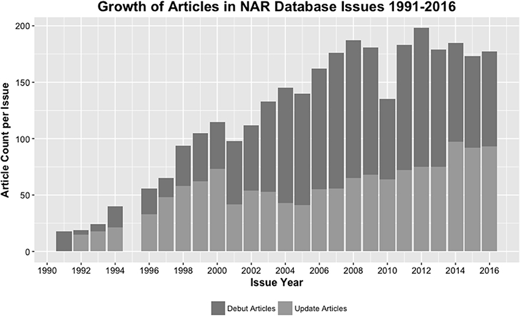{width=100%}
:::

::: {.column width="45%"}
Chaque année, la revue *Nucleic Acids Research* consacre un numéro aux bases de données :

- 2000 : 230 bases
- 2006 : 856
- 2021 : 1 697
- 2023 : 1 764

Chaque année : des **nouvelles**, des **mises à jour**… et des bases **retirées** ou plus maintenues.

[Rigden et Fernández, *NAR Database Issue*, éditoriaux annuels.]{.legende}
:::
::::

## D'où viennent ces données ?

:::: columns
::: {.column width="45%"}
- **Séquences** : génomes, transcrits, protéines
- **Expression** : puces, RNA-seq, *single-cell*
- **Structures** : protéines, complexes
- **Interactions et voies**
- **Variants** et **maladies**
- **Ontologies**, **littérature**
:::

::: {.column width="55%"}
::: fragment
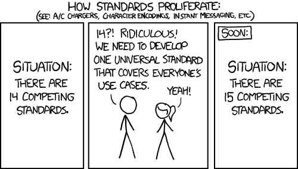{width=100%}

[xkcd 927, « Standards » (R. Munroe) : chaque nouvelle base veut unifier les autres… et en ajoute une.]{.legende}
:::
:::
::::

## Classer les bases de données

| Critère | Exemples |
|---|---|
| **Étendue** | généraliste (GenBank, UniProt) ou spécialisée (WormBase, une maladie, un organisme) |
| **Niveau** | **primaire** (données brutes, déposées) ou **secondaire** (données traitées, interprétées) |
| **Curation** | annotation **automatique** ou **experte** (manuelle) |
| **Type de données** | ADN, ARN, protéine, expression, voies, maladies, nomenclature, littérature, ontologies |

[Zou *et al.* (2015), *Biological databases for human research*, *Genomics Proteomics Bioinformatics*.]{.legende}

::: fragment
::: remarque
Avant d'utiliser une base : **qui** l'alimente, **comment** est-elle vérifiée, **quand** a-t-elle été mise à jour ?
:::
:::

## Les bases primaires

Elles contiennent les résultats expérimentaux **bruts**, tels que **déposés** par les chercheurs.

- **INSDC** : GenBank (NCBI, États-Unis), ENA (EMBL-EBI, Europe), DDBJ (Japon). Un consortium : elles **échangent leurs données chaque jour** et contiennent les mêmes séquences
- **SRA** (*Sequence Read Archive*) : les lectures NGS brutes. Le dépôt exige de décrire les échantillons et le plan d'expérience
- **GEO** (NCBI) : données d'expression (puces, RNA-seq), avec leurs métadonnées
- **PDB** : les structures 3D de macromolécules, avec les coordonnées des atomes

::: fragment
::: remarque
Le **dépôt** des séquences et des données brutes est une condition de publication dans la plupart des revues. C'est ce qui permet de **refaire** une analyse : `airway` est déposé dans GEO (GSE52778).
:::
:::

## Les bases secondaires

Elles **transforment** l'information brute en connaissances plus élaborées, par des programmes ou par des experts.

:::: columns
::: {.column width="50%"}
**UniProtKB** : les protéines

- **Swiss-Prot** : revue **manuellement** par des experts
- **TrEMBL** : annotée **automatiquement** (traduction des séquences de l'INSDC)
- TrEMBL est des centaines de fois plus grand que Swiss-Prot
:::

::: {.column width="50%"}
**Voies et réseaux**

- **Reactome** : réactions et voies, curation manuelle, libre
- **KEGG** : voies métaboliques et de signalisation ; licence payante pour le téléchargement complet
- **Gene Ontology** : les fonctions des gènes (section 3)
:::
::::

::: fragment
::: remarque
Une base secondaire contient souvent des informations **prédites** par un programme. Une analyse fondée sur des données incorrectes conduit à des conclusions erronées, **sans aucun message d'erreur**.
:::
:::

## Les limites des bases de données

:::: columns
::: {.column width="55%"}
- Des **erreurs** d'annotation et de séquençage, qui se **propagent** d'une base à l'autre par annotation automatique
- De la **redondance** : la même séquence sous plusieurs entrées
- Des **biais** : certaines branches de l'arbre du vivant (l'humain, la souris, les pathogènes) sont sur-représentées ; les gènes déjà étudiés sont les mieux annotés
- Des **versions** : la base change à chaque mise à jour, et vos résultats avec
:::

::: {.column width="45%"}
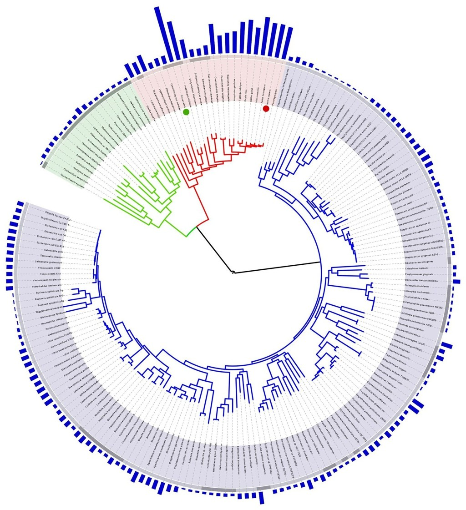{width=75%}
:::
::::

::: fragment
::: remarque
Remède partiel : un **vocabulaire contrôlé** (Gene Ontology, MeSH) au lieu de texte libre, et noter **la version** de chaque base utilisée.
:::
:::

## Interroger une base en ligne

- Un **portail** web avec des opérateurs booléens : `AND`, `OR`, `NOT`, des parenthèses, des guillemets pour une expression exacte
- Recherche **avancée** : chercher dans un **champ** précis (nom du gène, organisme, statut revu)
- Exemple sur <https://www.uniprot.org> :

```
BRCA1                                          → des milliers de résultats, toutes espèces
gene:BRCA1 AND organism_id:9606                → l'humain seulement
gene:BRCA1 AND organism_id:9606 AND reviewed:true → l'entrée Swiss-Prot P38398
```

::: fragment
::: remarque
Chaque filtre ajouté correspond à un champ d'une base **relationnelle**. C'est la même logique que `filter()` sur un tableau.
:::
:::

## À vous : primaire ou secondaire ? {.a-vous}

Pour chaque ressource, primaire ou secondaire ? Curation manuelle ou automatique ?

1. Les lectures FASTQ d'`airway` dans SRA
2. L'entrée Swiss-Prot P38398 (BRCA1)
3. Une entrée TrEMBL d'une protéine de bactérie séquencée en 2025
4. Le terme GO « *response to glucocorticoid* » associé à un gène avec le code d'évidence `IEA`

::: fragment
1. **Primaire** : les données brutes déposées
2. **Secondaire**, curation **manuelle** (experts) : la référence
3. **Secondaire**, **automatique** : une traduction de séquence, des fonctions prédites
4. **Secondaire**, **automatique** : `IEA` = *Inferred from Electronic Annotation*, personne ne l'a vérifiée (section suivante)
:::

# Les ontologies : un vocabulaire commun {.section-ul data-numero="3" background-color="#E30513"}

## Pourquoi une ontologie ?

- Un même processus décrit avec des mots différents : « apoptose », « mort cellulaire programmée », « *programmed cell death* »
- Une **ontologie** : un ensemble de **concepts** (termes) définis, chacun avec un **identifiant** stable, reliés par des **relations**
  - **hiérarchiques** : « est un » (*is a*), du général au particulier
  - **sémantiques** : « fait partie de » (*part of*), « régule » (*regulates*)
- Tout le monde parle **la même langue**, et une machine peut raisonner sur les termes

::: fragment
::: remarque
`GO:0051384` veut dire « *response to glucocorticoid* » pour tous les logiciels, dans toutes les langues, quel que soit le nom qu'un auteur lui donne.
:::
:::

## Gene Ontology (GO)

:::: columns
::: {.column width="50%"}
Trois branches indépendantes :

- **MF**, *Molecular Function* : l'activité moléculaire du produit du gène (« activité kinase »)
- **CC**, *Cellular Component* : où il agit (« mitochondrie »)
- **BP**, *Biological Process* : le processus auquel il contribue (« réponse aux glucocorticoïdes »)
:::

::: {.column width="50%"}
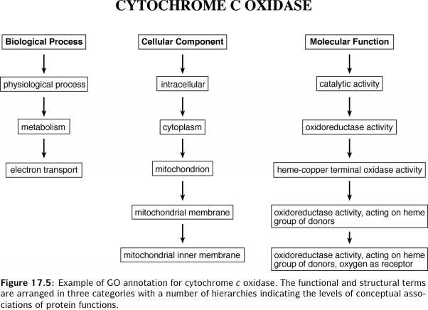{width=100%}

[Exemple : la cytochrome c oxydase dans les trois branches.]{.legende}
:::
::::

```{r}
#| echo: false
n_go <- AnnotationDbi::select(GO.db, keys(GO.db), "ONTOLOGY", "GOID") |> dplyr::count(ONTOLOGY)
```

::: fragment
Dans la version de `GO.db` installée : `r format(n_go$n[n_go$ONTOLOGY == "BP"], big.mark = " ")` termes BP, `r format(n_go$n[n_go$ONTOLOGY == "MF"], big.mark = " ")` MF, `r format(n_go$n[n_go$ONTOLOGY == "CC"], big.mark = " ")` CC.
:::

```{r}
#| echo: false
#| output: asis
# Propagation d'une annotation le long du graphe GO : trois diapos (graphe, annotation, propagation)
parents_de <- function(id) setdiff(as.list(GOBPPARENTS[id])[[1]], "all")
niveaux <- list("GO:0071385"); for (d in 2:4) niveaux[[d]] <- unique(unlist(lapply(niveaux[[d - 1]], parents_de)))
noeuds <- imap_dfr(niveaux, \(ids, d) tibble(id = ids, niveau = d, x = seq_along(ids) - (length(ids) + 1) / 2)) |>
  distinct(id, .keep_all = TRUE) |>
  mutate(terme = str_wrap(as.character(AnnotationDbi::Term(id)), 22),
         n_go = map_int(id, \(t) n_distinct(suppressMessages(AnnotationDbi::select(org.Hs.eg.db, t, "ENTREZID", "GO"))$ENTREZID)),
         n_goall = map_int(id, \(t) n_distinct(suppressMessages(AnnotationDbi::select(org.Hs.eg.db, t, "ENTREZID", "GOALL"))$ENTREZID)))
aretes <- noeuds |> mutate(parent = map(id, parents_de)) |> unnest(parent) |>
  inner_join(dplyr::select(noeuds, parent = id, xp = x, np = niveau), by = "parent")
graphe_go <- function(etape) {
  noeuds <- noeuds |> mutate(
    actif = case_when(etape == 1 ~ FALSE, etape == 2 ~ id == "GO:0071385", .default = TRUE),
    etiquette = if (etape == 3) sprintf("%s\nGO : %d · GOALL : %d", terme, n_go, n_goall) else terme)
  ggplot() +
    geom_segment(data = aretes, aes(x = x * 2.2, y = niveau, xend = xp * 2.2, yend = np),
                 colour = if (etape == 3) "#E30513" else "grey60", linewidth = 0.8,
                 arrow = arrow(length = unit(0.15, "inches")), lineend = "round") +
    geom_label(data = noeuds, aes(x * 2.2, niveau, label = etiquette, fill = actif),
               size = 4, label.padding = unit(0.3, "lines"), lineheight = 0.9) +
    scale_fill_manual(values = c(`FALSE` = "#F2F2F2", `TRUE` = "#F8D0D3"), guide = "none") +
    scale_x_continuous(expand = expansion(add = 1.6)) + scale_y_continuous(expand = expansion(add = 0.45)) +
    theme_void()
}
textes_go <- c("Un terme précis (en bas) et ses ancêtres : du **particulier** au **général**. Un terme peut avoir **plusieurs parents**.",
               "Un gène est annoté **seulement** à *cellular response to glucocorticoid stimulus*.",
               "**Règle du chemin vrai** : il compte aussi pour **tous les ancêtres**. GO = gènes annotés directement ; GOALL = avec les descendants.")
for (e in 1:3) {
  png <- sprintf("figure/anim/go_%d.png", e)
  ggsave(png, graphe_go(e), width = 11, height = 5.2, dpi = 150, bg = "white")
  cat(sprintf('\n\n## Un graphe, pas un arbre {auto-animate=true auto-animate-id="go"}\n\n%s\n\n{width=96%%}\n', textes_go[e], png))
}
```

## À l'échelle de GO

:::: columns
::: {.column width="45%"}
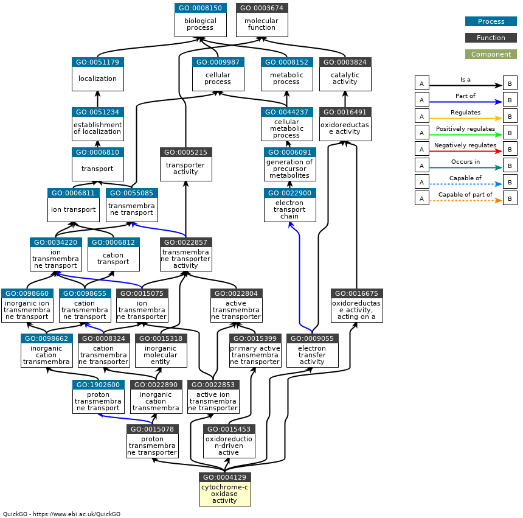{width=100%}
:::

::: {.column width="55%"}
- Des dizaines de milliers de termes, reliés en un **graphe orienté acyclique** (DAG)
- Relations conservées dans la version de base (`go-basic`) : *is a*, *part of*, *regulates* ; toutes respectent la règle du chemin vrai
- Dans `org.Hs.eg.db` : la clé `GO` donne les annotations **directes**, la clé `GOALL` les annotations **propagées**. Pour l'enrichissement, c'est `GOALL` qui compte
:::
::::

::: fragment
::: remarque
Conséquence pour l'enrichissement : un parent et ses enfants partagent **les mêmes gènes**. Les listes de résultats sont très **redondantes** (`simplify()` de `clusterProfiler` en retire une partie).
:::
:::

## Les codes d'évidence

Chaque annotation gène → terme GO porte un **code d'évidence** : sur quoi repose-t-elle ?

| Code | Signification | Fiabilité |
|---|---|---|
| `EXP`, `IDA`, `IMP`, `IPI` | expérience publiée (directe, mutant, interaction) | forte |
| `IBA`, `ISS` | inférée par phylogénie ou similarité de séquence | moyenne |
| `TAS` | *Traceable Author Statement* : affirmé dans un article | variable |
| `IEA` | *Inferred from Electronic Annotation* : automatique, **non revue** | à vérifier |

```{r}
#| echo: false
go_sparcl1 <- AnnotationDbi::select(org.Hs.eg.db, "SPARCL1", c("GO", "EVIDENCE"), "SYMBOL")
ev <- table(go_sparcl1$EVIDENCE)
```

::: fragment
*SPARCL1* : `r nrow(go_sparcl1)` annotations GO, dont `r ev[["IEA"]]` `IEA`. Les gènes les plus étudiés ont le plus d'annotations expérimentales : **l'ontologie reflète aussi ce qu'on a déjà cherché**.
:::

## MeSH et les autres ontologies

- **MeSH** (*Medical Subject Headings*) : vocabulaire contrôlé et hiérarchisé de la NLM, qui indexe les articles de **PubMed**
- **Disease Ontology** (DO), **Human Phenotype Ontology** (HPO) : maladies, phénotypes
- **Sequence Ontology**, **ChEBI** (molécules), **Cell Ontology**, **Uberon** (anatomie)…
- Le portail **OBO Foundry** fédère des ontologies biomédicales construites selon les mêmes principes

::: fragment
::: remarque
Toutes s'utilisent de la même façon pour l'enrichissement : un **ensemble de gènes** par terme. Seules la source et la qualité des annotations changent.
:::
:::

## Interroger GO dans R

Tous les packages d'annotation `.db` de Bioconductor s'interrogent **de la même manière** : `keytypes()`, `columns()`, `select()`.

```{r}
terme <- AnnotationDbi::select(GO.db, keys = "GO:0051384", keytype = "GOID",
                               columns = c("TERM", "ONTOLOGY", "DEFINITION"))
terme$TERM
terme$ONTOLOGY
strwrap(terme$DEFINITION, 70)
```

```{r}
as.list(GOBPPARENTS["GO:0051384"])   # parents dans la branche BP
```

# Identifiants et conversion {.section-ul data-numero="4" background-color="#E30513"}

## Un gène, plusieurs identifiants

:::: columns
::: {.column width="50%"}
| Système | *BRCA1* | Géré par |
|---|---|---|
| Symbole | `BRCA1` | HGNC |
| Entrez Gene | `672` | NCBI |
| Ensembl | `ENSG00000012048` | EMBL-EBI |
| UniProt | `P38398` | UniProt |
:::

::: {.column width="50%"}
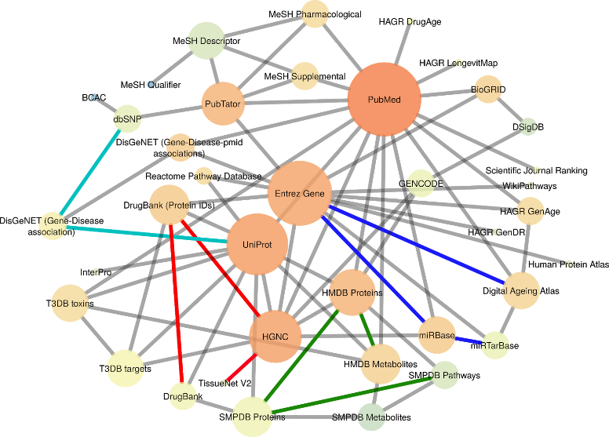{width=100%}

[Ongaro-Carcy *et al.* (2021), *Bioinformatics* (KibioR).]{.legende}
:::
::::

::: fragment
::: remarque
Chaque base a **son** identifiant. Les liens entre identifiants sont **eux-mêmes** une base de données, avec sa version, ses erreurs et ses trous.
:::
:::

## Le symbole officiel (HGNC)

- Attribué par le **HUGO Gene Nomenclature Committee** pour l'humain (MGI pour la souris : `Brca1`)
- Lisible, mais **pas stable** : il change quand la fonction est mieux comprise ou pour éviter une ambiguïté
- En 2020, *SEPT2* est devenu *SEPTIN2* et *MARCH1* est devenu *MARCHF1* : Excel les convertissait en **dates** (2-sept., 1-mars)

```{r}
AnnotationDbi::select(org.Hs.eg.db, keys = c("SEPT2", "MARCH1"),
                      keytype = "ALIAS", columns = "SYMBOL")
```

::: fragment
::: remarque
Environ **un article sur cinq** fournissant des listes de gènes dans Excel contenait des noms convertis en dates (Ziemann *et al.*, 2016, *Genome Biology*). Un ancien symbole peut aussi désigner **deux** gènes actuels : `SEPT2` → `SEPTIN2` **et** `SEPTIN6`.
:::
:::

## Entrez Gene et Ensembl

:::: columns
::: {.column width="50%"}
**Entrez Gene ID** (NCBI)

- un **entier** : `672`
- unique, stable, propre à une espèce
- utilisé par de nombreux outils d'enrichissement (KEGG, `clusterProfiler`)
:::

::: {.column width="50%"}
**Ensembl ID** (EMBL-EBI)

`ENS` + espèce + type + numéro + version

- `ENSG00000012048` : gène humain
- `ENSMUSG…` : gène de souris
- `ENST…` : transcrit ; `ENSP…` : protéine
- `ENSG00000012048.23` : la **version**
:::
::::

::: fragment
```{r}
ids <- c("ENSG00000152583.13", "ENSG00000096060.15")
sub("\\..*", "", ids)    # retirer la version avant de convertir
```

Si **tous** les identifiants portent une version : une erreur (`None of the keys entered are valid keys`). Si **quelques-uns** seulement : des `NA`, **sans erreur**.
:::

## Où convertir ?

- En ligne : **UniProt ID mapping** (<https://www.uniprot.org/id-mapping>), **g:Profiler g:Convert**, **BioMart** (Ensembl)
- Dans R, avec **BioMart** : interroge le serveur d'Ensembl, toujours à jour, **besoin d'Internet**

```{r}
#| eval: false
library(biomaRt)
ensembl <- useEnsembl(biomart = "genes", dataset = "hsapiens_gene_ensembl")
getBM(attributes = c("ensembl_gene_id", "hgnc_symbol", "entrezgene_id"),   # ce que l'on veut
      filters    = "entrezgene_id",                                         # ce que l'on a
      values     = c(672, 5468, 7157),                                      # nos valeurs
      mart       = ensembl)
```

- Dans R, **hors ligne** : les packages d'annotation de **Bioconductor** (`org.Hs.eg.db`), une version **figée**

## Bioconductor

- Un dépôt de packages R pour la bioinformatique, comme le CRAN, avec une **révision** plus stricte
- **Deux versions par an** (avril et octobre), chacune liée à une version de R
- Trois grandes familles :
  - **Software** : l'analyse (`DESeq2`, `clusterProfiler`, `limma`)
  - **AnnotationData** : génomes, annotations (`org.Hs.eg.db`, `GO.db`)
  - **ExperimentData** : des jeux de données prêts à l'emploi (`airway`)

```{r}
#| eval: false
install.packages("BiocManager")
BiocManager::install(c("org.Hs.eg.db", "clusterProfiler"))
```

## `org.Hs.eg.db` : une base dans un package

Une base **SQLite** : les correspondances entre identifiants, et les annotations GO, pour l'humain (`Hs`), centrée sur Entrez (`eg`).

```{r}
keytypes(org.Hs.eg.db)
```

```{r}
#| echo: false
md <- AnnotationDbi::metadata(org.Hs.eg.db)
date_de <- function(nom) md$value[md$name == nom]
```

::: fragment
Sources de la version installée : Entrez `r date_de("EGSOURCEDATE")`, GO `r date_de("GOSOURCEDATE")`, Ensembl `r date_de("ENSOURCEDATE")`… et KEGG **`r date_de("KEGGSOURCEDATE")`** : la licence de KEGG a changé en 2011, cette colonne n'a plus jamais été mise à jour.
:::

## `select()` : convertir {auto-animate=true auto-animate-id="select"}

```{r}
#| echo: false
#| results: asis
cat(code_annote(c("AnnotationDbi::select(" = NA,
                  "org.Hs.eg.db, " = "la base",
                  'keys = mes_ids, ' = "les valeurs que l'on a",
                  'keytype = "ENSEMBL", ' = "leur type",
                  'columns = c("SYMBOL", "ENTREZID")' = "ce que l'on veut",
                  ")" = NA),
                c("gris", "bleu", "vert", "vert", "jaune", "gris")))
```

```{r}
#| echo: false
mes_ids <- c("ENSG00000152583", "ENSG00000004866", "ENSG00000152268", "ENSG00000096060")
conv <- AnnotationDbi::select(org.Hs.eg.db, keys = mes_ids, keytype = "ENSEMBL", columns = c("SYMBOL", "ENTREZID"))
ids_conv <- matrix(paste0("c-", rep(seq_len(nrow(conv)), 3), "-", rep(1:3, each = nrow(conv))), ncol = 3)
ids_conv[, 1] <- paste0("e-", conv$ENSEMBL, "-", seq_len(nrow(conv)))
ids_conv[match(mes_ids, conv$ENSEMBL), 1] <- paste0("e-", mes_ids)
```

```{r}
#| echo: false
#| results: asis
cat(rangee(tableau(tibble(ENSEMBL = mes_ids), cles = mes_ids, prefixe = "e-", titre = "mes_ids : 4 gènes",
                   ids = matrix(paste0("e-", mes_ids)))))
```

## `select()` : convertir {auto-animate=true auto-animate-id="select"}

```{r}
#| echo: false
#| results: asis
cat(code_annote(c("AnnotationDbi::select(" = NA,
                  "org.Hs.eg.db, " = "la base",
                  'keys = mes_ids, ' = "les valeurs que l'on a",
                  'keytype = "ENSEMBL", ' = "leur type",
                  'columns = c("SYMBOL", "ENTREZID")' = "ce que l'on veut",
                  ")" = NA),
                c("gris", "bleu", "vert", "vert", "jaune", "gris")))
```

```{r}
#| echo: false
#| results: asis
dup <- which(duplicated(conv$ENSEMBL) | duplicated(conv$ENSEMBL, fromLast = TRUE))
cat(rangee(tableau(conv, ids = ids_conv, cols_new = c("SYMBOL", "ENTREZID"), lignes_hl = dup,
                   lignes_na = which(is.na(conv$SYMBOL)), titre = sprintf("résultat : %d lignes", nrow(conv)))))
```

::: fragment
- **Un-à-plusieurs** : `ENSG00000004866` donne **deux** lignes (*ST7* et *ST7-OT3*). Message : `'select()' returned 1:many mapping`
- **Aucune correspondance** : `NA`, sans erreur. Le tableau n'a plus le même nombre de lignes que `mes_ids`
:::

## `mapIds()` : une valeur par identifiant

```{r}
mapIds(org.Hs.eg.db, keys = mes_ids, keytype = "ENSEMBL", column = "SYMBOL")
```

- **Un seul** résultat par clé, dans **le même ordre** : on peut l'ajouter comme colonne avec `mutate()`
- `multiVals = "first"` (défaut) : en cas de choix, garde le **premier**… et ne dit pas lequel il a écarté
- `multiVals = "list"` : tous les résultats, dans une liste

```{r}
mapIds(org.Hs.eg.db, keys = "ENSG00000004866", keytype = "ENSEMBL",
       column = "SYMBOL", multiVals = "list")
```

## Sur nos `r nrow(de)` gènes DE

```{r}
de_annot <- de |>
  mutate(symbole = mapIds(org.Hs.eg.db, keys = gene, keytype = "ENSEMBL", column = "SYMBOL"))
sum(is.na(de_annot$symbole))
de_annot |> arrange(desc(log2FoldChange)) |> filter(!is.na(symbole)) |> head(5)
```

::: fragment
::: remarque
`r sum(is.na(de_annot$symbole))` gènes DE sans symbole : des gènes **réels**, mais absents de cette version de la base (ou non codants). Ils disparaîtront **en silence** de toute analyse qui passe par les symboles.
:::
:::

## Piège : `select()` masqué

`library(org.Hs.eg.db)` charge `AnnotationDbi`, qui a **sa propre** fonction `select()` :

```{r}
#| error: true
res |> select(gene, padj)
```

::: fragment
- Même famille que `count()` masqué par DESeq2 : lisez les messages `The following object is masked…` au chargement
- Écrire **explicitement** le package : `dplyr::select()` pour les colonnes, `AnnotationDbi::select()` pour les conversions
:::

## À vous : prédire une conversion {.a-vous}

```{r}
#| eval: false
ids <- c("ENSG00000152583.13", "ENSG00000004866", "ENSG00000096060")
conv <- AnnotationDbi::select(org.Hs.eg.db, keys = ids, keytype = "ENSEMBL", columns = "SYMBOL")
nrow(conv)
```

1. Combien de lignes ? Combien de `NA` ?
2. Même question avec `mapIds()`.
3. Vous aviez 3 gènes, vous écrivez `cbind(mes_resultats, conv)`. Que se passe-t-il ?

::: fragment
1. **4 lignes** : un `NA` (la version `.13` empêche la correspondance) et **deux** lignes pour `ENSG00000004866`
2. **3 valeurs**, une par clé, dans l'ordre : `NA`, `ST7` (le premier), `FKBP5`
3. Avec 3 lignes contre 4, `cbind()` refuse ; mais si les tailles tombaient juste, les lignes seraient **décalées** sans message. Joindre par l'identifiant (`left_join()`), et compter les lignes avant et après
:::

# TP1 {.section-ul background-color="#E30513"}

# L'analyse de sur-représentation {.section-ul data-numero="5" background-color="#E30513"}

## De la liste de gènes à la fonction

:::: columns
::: {.column width="45%"}
**`r nrow(de)` gènes DE**

- *SPARCL1* est associé à…
- *FKBP5* est associé à…
- *DUSP1* est associé à…
- …
:::

::: {.column width="55%"}
Parmi les gènes DE, y a-t-il des **thèmes communs** ?

Un thème « commun » dépend :

- de la **taille de la liste** de gènes DE
- du **nombre total** de gènes
- de la **taille du thème** (combien de gènes il contient)
:::
::::

::: fragment
::: remarque
11 gènes DE dans « *response to glucocorticoid* » : beaucoup ou peu ? Tout dépend de **combien on en attendait par hasard**.
:::
:::

## L'urne

:::: columns
::: {.column width="45%"}
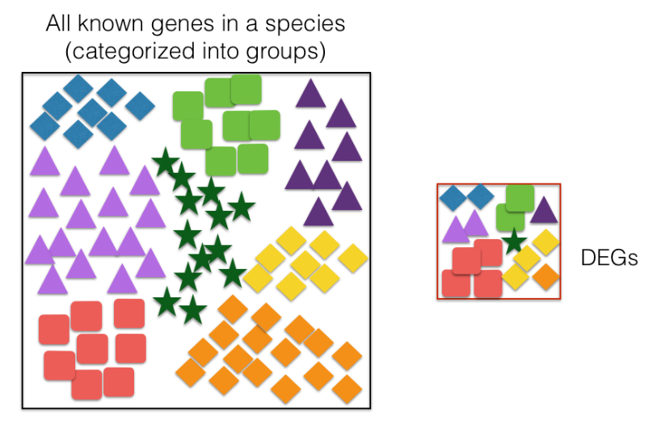{width=100%}
:::

::: {.column width="55%"}
- Une urne de **N** gènes : l'**univers**
- **K** sont dans le terme GO (les étoiles)
- On tire **n** gènes : la liste DE
- On observe **k** étoiles dans le tirage

Si la liste DE était tirée **au hasard**, combien d'étoiles ? En moyenne **n × K / N**.

La probabilité d'en voir **k ou plus** suit une loi **hypergéométrique** : c'est le **test exact de Fisher** unilatéral.
:::
::::

## Le tableau de contingence {auto-animate=true auto-animate-id="conting"}

```{r}
#| echo: false
gc <- AnnotationDbi::select(org.Hs.eg.db, keys = "GO:0051384", keytype = "GOALL", columns = "ENSEMBL")
dans_go <- unique(gc$ENSEMBL)
N <- nrow(testes); K <- sum(testes$gene %in% dans_go)
n <- nrow(induits); k <- sum(induits$gene %in% dans_go)
sym_jouet <- c("FKBP5", "DUSP1", "SPARCL1", "KLF9", "ACTB", "GAPDH", "PER1", "MYH11")
ens_jouet <- mapIds(org.Hs.eg.db, sym_jouet, "ENSEMBL", "SYMBOL")
jouet <- tibble(gene = sym_jouet,
                DE = if_else(ens_jouet %in% induits$gene, "oui", "non"),
                GO = if_else(ens_jouet %in% dans_go, "oui", "non"))
```

Chaque gène de l'univers : est-il **DE** ? est-il dans le **terme GO** ?

```{r}
#| echo: false
#| results: asis
cat(rangee(tableau(jouet, cle = "gene", cols_hl = c("DE", "GO"), lignes_hl = which(jouet$DE == "oui" & jouet$GO == "oui"),
                   titre = "l'univers (extrait)")))
```

::: legende
8 gènes de l'univers ; DE = induit (`padj` < 0.05, log2FC > 1) ; GO = annoté à *response to glucocorticoid* ou à l'un de ses descendants.
:::

## Le tableau de contingence {auto-animate=true auto-animate-id="conting"}

On compte les quatre cases, pour les `r format(N, big.mark = " ")` gènes testés et les `r n` gènes **induits** :

```{r}
#| echo: false
#| results: asis
cont <- tibble(` ` = c("DE (induits)", "non DE", "total"),
               `dans le terme` = c(k, K - k, K),
               `hors du terme` = c(n - k, N - K - (n - k), N - K),
               total = c(n, N - n, N))
cat(rangee(tableau(cont, cle = " ", cases_hl = rbind(c(1, 2)), titre = "response to glucocorticoid (GO:0051384)")))
```

::: fragment
- Observé : **k = `r k`** gènes induits dans le terme
- Attendu par hasard : n × K / N = `r n` × `r K` / `r format(N, big.mark = " ")` ≈ **`r round(n * K / N, 1)`**
- `r round(k / (n * K / N), 1)` fois plus que le hasard. Est-ce significatif ?
:::

## Le test de Fisher

```{r}
tab <- matrix(c(k, K - k, n - k, N - K - (n - k)), nrow = 2,
              dimnames = list(c("DE", "non DE"), c("dans", "hors")))
tab
fisher.test(tab, alternative = "greater")$p.value
phyper(k - 1, K, N - K, n, lower.tail = FALSE)   # la même chose, avec la loi hypergéométrique
```

::: fragment
`alternative = "greater"` : on cherche une **sur**-représentation. Mais il y a des milliers de termes GO…
:::

## Des milliers de tests

:::: columns
::: {.column width="40%"}
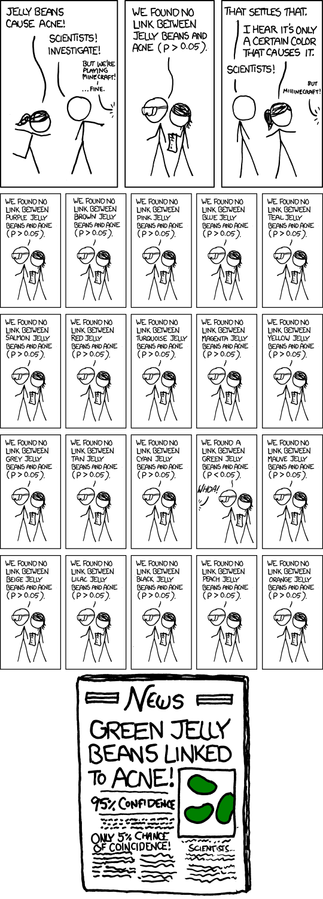{width=80%}

[xkcd 882, « Significant » (R. Munroe).]{.legende}
:::

::: {.column width="60%"}
- Un test de Fisher **par terme** : des milliers de termes GO testés
- Au seuil de 5 %, sans correction : des dizaines de termes « enrichis » **par hasard**
- Même remède qu'en expression différentielle : **Benjamini-Hochberg** (FDR), `p.adjust`
- Les termes ne sont pas indépendants (parents, enfants) : la correction reste approximative

::: remarque
Deux étages de tests multiples : des milliers de **gènes** (DESeq2), puis des milliers de **termes** (ORA).
:::
:::
::::

## L'ORA dans R : `enrichGO()`

```{r}
ora_induits <- enrichGO(gene     = induits$gene,      # la liste : les gènes induits
                        universe = testes$gene,       # l'univers : les gènes testés
                        OrgDb    = org.Hs.eg.db,
                        keyType  = "ENSEMBL",
                        ont      = "BP",              # Biological Process
                        pAdjustMethod = "BH",
                        readable = TRUE)              # afficher des symboles
```

```{r}
#| R.options: {width: 110}
as_tibble(ora_induits) |>
  dplyr::select(Description, GeneRatio, BgRatio, p.adjust, Count) |>
  head(6)
```

## Lire le résultat

```{r}
#| echo: false
ligne_gc <- as_tibble(ora_induits) |> filter(ID == "GO:0051384")
```

| Colonne | Sens | *response to glucocorticoid* |
|---|---|---|
| `GeneRatio` | k / n : gènes de la liste dans le terme / gènes de la liste **annotés** | `r ligne_gc$GeneRatio` |
| `BgRatio` | K / N : gènes de l'univers dans le terme / univers **annoté** | `r ligne_gc$BgRatio` |
| `p.adjust` | p-value ajustée (BH) | `r signif(ligne_gc$p.adjust, 2)` |

`geneID` : les gènes de la liste dans le terme, ici `r str_replace_all(ligne_gc$geneID, "/", ", ")`.

::: fragment
::: remarque
Le dénominateur de `GeneRatio` n'est pas `r n` : seuls les gènes qui ont **au moins une annotation GO BP** comptent. Les autres sont **retirés sans message**. N et n diffèrent donc de notre calcul à la main, et la p-value aussi.
:::
:::

## Visualiser une ORA

```{r}
#| fig-width: 10
#| fig-height: 5
#| out-width: "85%"
dotplot(ora_induits, showCategory = 12) + theme(axis.text.y = element_text(size = 11))
```

::: legende
Taille du point : nombre de gènes ; couleur : `p.adjust` ; x : `GeneRatio`.
:::

```{r}
#| echo: false
#| output: asis
# L'urne avec et sans univers : la même liste, le même terme, deux attentes différents
ora_sans_univers <- enrichGO(gene = induits$gene, OrgDb = org.Hs.eg.db, keyType = "ENSEMBL", ont = "BP")
lire_ratio <- function(x) as.integer(str_split_fixed(x, "/", 2))
urne <- function(o, nom) {
  l <- o@result[o@result$ID == "GO:0051384", ]
  gr <- lire_ratio(l$GeneRatio); bg <- lire_ratio(l$BgRatio)
  tibble(univers = nom, k = gr[1], n = gr[2], K = bg[1], N = bg[2], attendu = n * K / N, p.adjust = l$p.adjust)
}
deux_urnes <- bind_rows(urne(ora_induits, "gènes testés"), urne(ora_sans_univers, "génome annoté"))
tab_urne <- function(lignes, new = NULL) {
  deux_urnes[lignes, ] |>
    transmute(urne = univers, N = format(N, big.mark = " "), K, n, k,
              attendu = round(attendu, 1), `obs. / att.` = round(k / attendu, 1)) |>
    tableau(cle = "urne", lignes_new = new, cols_hl = c("attendu", "obs. / att."), titre = "response to glucocorticoid, gènes induits")
}
textes_u <- c("L'urne = les gènes **testés** : ceux qui **auraient pu** être DE.",
              "Sans `universe` : on ajoute à l'urne des milliers de gènes **non exprimés**, qui ne pouvaient **pas** être tirés.")
for (e in 1:2) {
  cat(sprintf('\n\n## L\'univers change l\'attendu {auto-animate=true auto-animate-id="univers"}\n\n%s\n\n%s\n',
              textes_u[e], rangee(tab_urne(seq_len(e), new = if (e == 2) 2 else NULL))))
  if (e == 1) cat('\n::: legende\nN : gènes de l\'urne ; K : dans le terme ; n : gènes de la liste ; k : de la liste dans le terme (gènes annotés seulement).\n:::\n')
  if (e == 2) cat('\n::: fragment\nL\'urne grossit (N), le terme un peu (K) : l\'**attendu baisse**, le terme paraît **plus** enrichi. Même liste, même biologie, autre conclusion.\n:::\n')
}
```

## Piège : l'univers

```{r}
#| eval: false
ora_sans_univers <- enrichGO(gene = induits$gene, OrgDb = org.Hs.eg.db,
                             keyType = "ENSEMBL", ont = "BP")   # pas de 'universe'
```

```{r}
#| echo: false
bg_avec <- str_extract(ora_induits@result$BgRatio[1], "\\d+$")
bg_sans <- str_extract(ora_sans_univers@result$BgRatio[1], "\\d+$")
```

- Sans `universe`, l'univers = **tous** les gènes humains annotés : `r format(as.integer(bg_sans), big.mark = " ")` au lieu de `r format(as.integer(bg_avec), big.mark = " ")`
- Or un gène **non exprimé** dans ces cellules ne pouvait **pas** être DE : on le compte dans l'urne alors qu'il n'avait aucune chance d'être tiré
- Résultat : `r nrow(as_tibble(ora_sans_univers))` termes significatifs au lieu de `r nrow(as_tibble(ora_induits))`. Un terme dont les gènes sont simplement **exprimés** dans ces cellules paraît enrichi, sans rapport avec le **traitement**

::: fragment
::: remarque
L'univers = les gènes qui **auraient pu** être dans la liste : les gènes **testés** (`padj` non `NA`). Les outils web l'oublient presque tous par défaut (Timmons *et al.*, 2015 ; Wijesooriya *et al.*, 2022).
:::
:::

## Piège : mélanger induits et réprimés

```{r}
#| echo: false
ora_reprimes <- enrichGO(reprimes$gene, universe = testes$gene, OrgDb = org.Hs.eg.db, keyType = "ENSEMBL", ont = "BP")
ora_tous <- enrichGO(de$gene, universe = testes$gene, OrgDb = org.Hs.eg.db, keyType = "ENSEMBL", ont = "BP")
id_sens <- union(as_tibble(ora_induits)$ID, as_tibble(ora_reprimes)$ID)
id_tous <- as_tibble(ora_tous)$ID
stopifnot(!"GO:0051384" %in% id_tous, "GO:0051384" %in% id_sens)  # cité dans la diapo
```

| Liste | Gènes | Termes BP significatifs |
|---|---|---|
| induits | `r nrow(induits)` | `r nrow(as_tibble(ora_induits))` |
| réprimés | `r nrow(reprimes)` | `r nrow(as_tibble(ora_reprimes))` |
| les deux ensemble | `r nrow(de)` | `r nrow(as_tibble(ora_tous))` |

- Ensemble, un terme « enrichi » ne dit plus **dans quel sens** la fonction change
- `r length(setdiff(id_sens, id_tous))` termes significatifs dans un sens **disparaissent** dans la liste commune, dilués, dont *response to glucocorticoid* ; `r length(setdiff(id_tous, id_sens))` termes n'**apparaissent** que dans la liste commune
- Faire **une ORA par sens**, et le dire

::: fragment
::: remarque
« Enrichi » ne veut jamais dire « activé ». Un terme enrichi parmi les gènes induits peut contenir des **inhibiteurs** de la voie.
:::
:::

```{r}
#| echo: false
#| output: asis
# Mélanger induits et réprimés : la liste double, k ne bouge presque pas
deux_listes <- bind_rows(urne(ora_induits, "induits seuls"), urne(ora_tous, "induits + réprimés"))
tab_mel <- function(lignes, new = NULL) {
  deux_listes[lignes, ] |>
    transmute(liste = univers, n, k, attendu = round(attendu, 1),
              `obs. / att.` = round(k / attendu, 1), p.adjust = signif(p.adjust, 2)) |>
    tableau(cle = "liste", lignes_new = new, cols_hl = c("k", "obs. / att."), titre = "response to glucocorticoid")
}
textes_m <- c(sprintf("Les gènes **induits** seuls : %d dans le terme, %s fois l'attendu.", deux_listes$k[1], format(round(deux_listes$k[1] / deux_listes$attendu[1], 1), decimal.mark = ",")),
              sprintf("On ajoute les **réprimés** : la liste double, mais %d gène de plus dans le terme. L'attendu double, le signal est **dilué**.", deux_listes$k[2] - deux_listes$k[1]))
for (e in 1:2) {
  cat(sprintf('\n\n## Pourquoi le terme disparaît {auto-animate=true auto-animate-id="melange"}\n\n%s\n\n%s\n',
              textes_m[e], rangee(tab_mel(seq_len(e), new = if (e == 2) 2 else NULL))))
}
```

## Les outils en ligne

| Outil | Adresse | Particularité |
|---|---|---|
| **g:Profiler** | <https://biit.cs.ut.ee/gprofiler> | GO, voies, facteurs de transcription ; version de la base indiquée ; aussi en R (`gprofiler2`) |
| **Enrichr** | <https://maayanlab.cloud/Enrichr> | des centaines de collections (maladies, tissus, médicaments) |
| **ToppGene** | <https://toppgene.cchmc.org> | priorisation de gènes |
| **DAVID** | <https://davidbioinformatics.nih.gov> | historique, très cité |

::: fragment
::: remarque
Rapide et pratique, mais : préciser l'**univers**, noter la **version** des annotations et la **date**, et vérifier la **correction** des tests multiples. Une analyse faite sur un site web en 2026 ne se refera pas à l'identique en 2027.
:::
:::

## Les limites de l'ORA

- Il faut un **seuil** pour faire la liste (`padj` < 0.05, |log2FC| > 1) : arbitraire, et les résultats en dépendent
- Un gène juste sous le seuil compte **autant** qu'un gène non exprimé ; un gène à log2FC = 8 compte **autant** qu'un gène à log2FC = 1,1
- Aucune liste si l'effet est faible et diffus (des dizaines de gènes qui bougent un peu)
- Suppose les gènes **indépendants** ; or les gènes d'une voie sont souvent co-régulés
- **Biais de longueur** en RNA-seq : les gènes longs ont plus de lectures, donc plus de chances d'être DE (`goseq` le corrige)

::: fragment
::: remarque
La GSEA répond aux trois premières limites : **pas de seuil**, tous les gènes, classés.
:::
:::

## À vous : lire une ORA {.a-vous}

Un étudiant envoie sa liste de 400 gènes réprimés sur un site web, avec les réglages par défaut, et obtient :

```
term                                  GeneRatio   BgRatio      p-value
extracellular matrix organization     24/312      330/19800    2.1e-06
```

1. Combien de gènes de la liste sont dans le terme ? Combien en attendait-on par hasard ?
2. Pourquoi 312 et non 400 ?
3. Quel est l'univers utilisé ? Est-ce un problème ?
4. Il conclut : « le traitement active l'organisation de la matrice extracellulaire ». Deux objections.

::: fragment
1. **24** ; attendu 312 × 330 / 19 800 ≈ **5,2**
2. 88 gènes n'ont **aucune annotation** dans cette ontologie : retirés en silence
3. Tous les gènes annotés du génome (**19 800**), pas les gènes testés : enrichissement probablement **surestimé**
4. Une **p-value brute** (des milliers de termes testés : il faut `p.adjust`) ; et des gènes **réprimés** ne disent pas « active ». Enrichi ≠ activé
:::

# La GSEA {.section-ul data-numero="6" background-color="#E30513"}

## L'idée

:::: columns
::: {.column width="45%"}
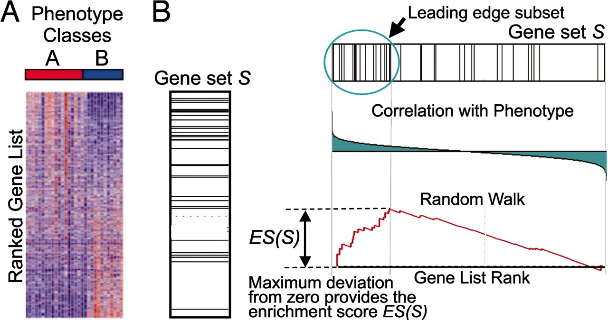{width=100%}

[Subramanian *et al.* (2005), *PNAS*.]{.legende}
:::

::: {.column width="55%"}
*Gene Set Enrichment Analysis*

- **Tous** les gènes, pas seulement les DE : **aucun seuil**
- Les gènes sont **classés** selon une statistique (ici la `stat` de Wald de DESeq2)
- Question : les gènes d'un ensemble sont-ils **regroupés en haut** (ou en bas) du classement, plutôt que répartis au hasard ?
:::
::::

::: fragment
::: remarque
Un ensemble dont les gènes montent tous **un peu**, sans qu'aucun ne passe le seuil, est invisible pour l'ORA. La GSEA le voit : ses gènes sont regroupés en haut du classement.
:::
:::

## Classer les gènes

```{r}
classement <- testes |> arrange(desc(stat))
liste_gsea <- setNames(classement$stat, classement$gene)   # un vecteur nommé, trié
head(liste_gsea, 4)
tail(liste_gsea, 4)
```

- En haut : les plus **induits**, avec certitude ; en bas : les plus **réprimés**
- `stat` = log2FC / lfcSE : combine l'**effet** et la **précision**
- Le classement a un **sens** : tout dépend du niveau de référence (`dex trt vs untrt`)

```{r}
#| echo: false
#| output: asis
# Somme courante pas à pas : une diapo par étape (tableau HTML animé + courbe enregistrée en PNG)
jg <- tibble(rang = 1:12, gene = paste0("g", 1:12),
             `dans S` = c("oui", "oui", "non", "oui", "non", "oui", "non", "non", "oui", "non", "non", "non"))
pas <- ifelse(jg$`dans S` == "oui", 1, -0.5)
jg_somme <- jg |> mutate(somme = cumsum(pas))
etapes <- c(0, 2, 4, 6, 9, 12)
textes <- c("On parcourt la liste classée **de haut en bas**. La somme part de **0**.",
            "g1 et g2 sont dans l'ensemble S : **+1**, **+1**.",
            "g3 n'est pas dans S : **−0,5**. g4 l'est : **+1**.",
            "Avec g6, la somme atteint **3** : son maximum.",
            "Les gènes hors de S la font redescendre ; g9 la remonte à 3.",
            "Fin de la liste. **ES = 3**, l'écart maximal à zéro. Positif : S est en **haut** du classement.")
for (i in seq_along(etapes)) {
  r <- etapes[i]
  d <- jg |> mutate(pas = if_else(rang <= r, if_else(`dans S` == "oui", "+1", "−0,5"), ""),
                    somme = if_else(rang <= r, format(jg_somme$somme, trim = TRUE), ""))
  html <- tableau(d, cle = "gene", cols_hl = "dans S", lignes_hl = which(jg$`dans S` == "oui"),
                  lignes_off = if (r < 12) which(jg$rang > r) else NULL,
                  cases_hl = if (r > 0) rbind(c(r, 5)) else NULL, titre = "liste classée (jouet)")
  courbe <- bind_rows(tibble(rang = 0, somme = 0), filter(jg_somme, rang <= r))
  g <- ggplot(courbe, aes(rang, somme)) +
    geom_hline(yintercept = 0, colour = "grey60") +
    geom_step(colour = "#4A7FC1", linewidth = 1.2, direction = "hv") +
    geom_point(data = filter(jg_somme, rang <= r, `dans S` == "oui"), colour = "#E30513", size = 3) +
    scale_x_continuous(breaks = 0:12, limits = c(0, 12)) +
    scale_y_continuous(limits = c(-0.5, 3.6)) +
    labs(x = "rang", y = "somme courante") +
    theme_minimal(base_size = 16)
  if (r == 12) g <- g + annotate("segment", x = 6, xend = 6, y = 0, yend = 3, colour = "#1F5FB0",
                                 linetype = 2, linewidth = 1) +
    annotate("text", x = 8.6, y = 3.4, label = "ES = 3", colour = "#1F5FB0", size = 6)
  png <- sprintf("figure/anim/somme_%02d.png", r)
  ggsave(png, g, width = 5.5, height = 4.4, dpi = 150, bg = "white")
  cat(sprintf('\n\n## La somme courante {auto-animate=true auto-animate-id="gsea"}\n\n%s\n\n:::: columns\n::: {.column width="52%%"}\n%s\n:::\n\n::: {.column width="48%%"}\n{width=100%%}\n:::\n::::\n',
              textes[i], rangee(html), png))
}
```

## Le vrai calcul

- Les pas sont **pondérés** : un gène de S monte d'autant plus que sa `stat` est forte ; les pas des autres gènes sont calculés pour que la somme revienne à **0** à la fin
- La statistique ressemble à celle de **Kolmogorov-Smirnov** : l'écart maximal entre deux distributions cumulées
- **Significativité** : on **permute** (les gènes ou les échantillons) des milliers de fois et on recalcule l'ES. La p-value = la proportion d'ES permutés au moins aussi extrêmes
- **NES** (*normalized ES*) : l'ES divisé par la moyenne des ES permutés, pour comparer des ensembles de **tailles** différentes
- Puis correction pour les tests multiples (BH) sur tous les ensembles

::: fragment
::: remarque
Les **gènes moteurs** (*leading edge*) : les gènes de S situés **avant** le pic. Ce sont eux qui portent l'enrichissement.
:::
:::

## La GSEA dans R : `gseGO()`

```{r}
gsea_go <- gseGO(geneList = liste_gsea,      # le vecteur nommé et trié
                 OrgDb    = org.Hs.eg.db,
                 keyType  = "ENSEMBL",
                 ont      = "BP",
                 minGSSize = 15, maxGSSize = 500,   # tailles d'ensembles retenues
                 seed     = TRUE)                    # permutations reproductibles
```

```{r}
#| R.options: {width: 110}
as_tibble(gsea_go) |>
  dplyr::select(Description, setSize, NES, p.adjust) |>
  arrange(desc(NES)) |> head(4)
```

::: legende
`There are ties in the preranked stats` : des gènes à égalité dans le classement, dont l'ordre sera arbitraire. Un avertissement, pas une erreur.
:::

## Le graphique de GSEA

```{r}
#| echo: false
id_gc <- "GO:0051384"
ligne_gsea <- as_tibble(gsea_go) |> filter(ID == id_gc)
```

:::: columns
::: {.column width="60%"}
```{r}
#| out-width: "100%"
#| fig-width: 7
#| fig-height: 5.5
gseaplot2(gsea_go, geneSetID = "GO:0051384",
          title = "response to glucocorticoid")
```
:::

::: {.column width="40%"}
- **En haut** : la somme courante ; son pic = l'ES
- **Au milieu** : chaque trait = un gène de l'ensemble, à son rang
- **En bas** : la statistique de classement
- Ici : NES = `r round(ligne_gsea$NES, 2)`, `p.adjust` = `r signif(ligne_gsea$p.adjust, 2)` ; l'ensemble est en **haut** : **induit** par la dexaméthasone
:::
::::

## Lire le signe du NES

```{r}
as_tibble(gsea_go) |> dplyr::count(sens = if_else(NES > 0, "NES > 0", "NES < 0"))
```

- **NES > 0** : l'ensemble est en haut du classement, ses gènes tendent à être **plus** exprimés chez les traités
- **NES < 0** : en bas, **moins** exprimés chez les traités

::: fragment
::: remarque
Le signe vient du classement, donc du **niveau de référence** de DESeq2. Avec `untrt vs trt`, **tous** les NES changent de signe : même erreur silencieuse qu'en statistiques. Lire l'en-tête de `res` **avant** l'enrichissement.
:::
:::

## Où trouver des ensembles de gènes ?

:::: columns
::: {.column width="50%"}
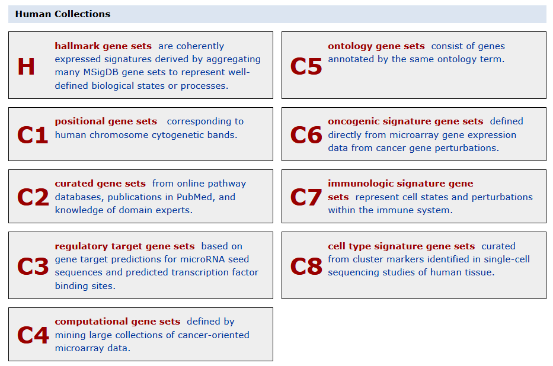{width=100%}
:::

::: {.column width="50%"}
**MSigDB** (*Molecular Signatures Database*, Broad Institute)

- Des collections : **H** (*hallmarks*), C2 (voies : KEGG, Reactome), C5 (GO), C7 (immunologie)…
- **Hallmarks** : 50 ensembles de référence, peu redondants, chacun résumant un processus bien défini (Liberzon *et al.*, 2015)
- Dans R : `msigdbr`, ou un fichier GMT téléchargé
:::
::::

::: fragment
Et aussi : GO, KEGG, Reactome, WikiPathways, Disease Ontology… La GSEA accepte **n'importe quel** ensemble de gènes.
:::

## Le format GMT

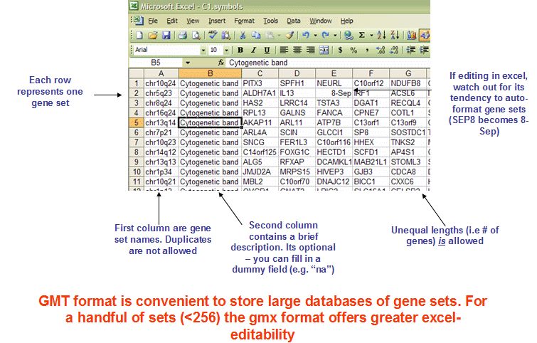{width=75% fig-align="center"}

- *Gene Matrix Transposed* : une ligne par ensemble ; le nom, une description, puis les gènes
- Lecture : `read.gmt()` (`clusterProfiler`) → un tableau à deux colonnes `term`, `gene`
- Analyse avec ses propres ensembles : `GSEA(liste, TERM2GENE = tableau)` ou `enricher()` pour une ORA

::: legende
Ouvrir un GMT dans Excel : les symboles *SEPT2*, *MARCH1*… redeviennent des dates.
:::

## Les Hallmarks : un bon point de départ

```{r}
#| eval: false
hallmarks <- read.gmt("/home/public/enrichissement/h.all.Hs.ensembl.gmt")
```

```{r}
#| echo: false
# copie locale de /home/public/enrichissement/h.all.Hs.ensembl.gmt (MSigDB, msigdbr, voir data/_prepare.R)
hallmarks <- read.gmt("data/h.all.Hs.ensembl.gmt")
version_msigdb <- str_split_i(readLines("data/h.all.Hs.ensembl.gmt", n = 1), "\t", 2)
```

```{r}
head(hallmarks, 3)
gsea_h <- GSEA(geneList = liste_gsea, TERM2GENE = hallmarks, seed = TRUE)
```

```{r}
#| R.options: {width: 110}
as_tibble(gsea_h) |> dplyr::select(ID, setSize, NES, p.adjust) |> arrange(desc(NES)) |> head(5)
```

::: legende
`r version_msigdb`, `r n_distinct(hallmarks$term)` ensembles. Le même vecteur classé que pour `gseGO()` ; seuls les ensembles changent.
:::

## Lire les Hallmarks

```{r}
#| echo: false
gh <- as_tibble(gsea_h)
nfkb <- gh |> filter(ID == "HALLMARK_TNFA_SIGNALING_VIA_NFKB")
moteurs_nfkb <- mapIds(org.Hs.eg.db, str_split_1(nfkb$core_enrichment, "/"), "SYMBOL", "ENSEMBL")
freins <- intersect(c("DUSP1", "NFKBIA", "TNFAIP3", "ZFP36", "TNIP1", "TNIP2"), moteurs_nfkb)
stopifnot(length(freins) >= 4)  # cité dans la diapo
```

:::: columns
::: {.column width="50%"}
```{r}
#| echo: false
#| out-width: "100%"
#| fig-width: 6.5
#| fig-height: 5.5
gh |>
  mutate(nom = str_remove(ID, "HALLMARK_") |> str_replace_all("_", " ") |> str_to_lower(),
         nom = fct_reorder(nom, NES)) |>
  ggplot(aes(NES, nom, fill = NES > 0)) +
  geom_col() +
  scale_fill_manual(values = c(`TRUE` = "#E30513", `FALSE` = "#4A7FC1"), guide = "none") +
  labs(x = "NES", y = NULL) +
  theme_minimal(base_size = 14)
```
:::

::: {.column width="50%"}
- `r nrow(gh)` Hallmarks sur `r n_distinct(hallmarks$term)` significatifs, **peu redondants** : 50 ensembles au lieu de milliers de termes GO
- **Adipogenèse** en tête : la dexaméthasone fait partie des cocktails de différenciation des adipocytes
- **TNFα via NF-κB, NES > 0** : la dexaméthasone, un anti-inflammatoire, « active » l'inflammation ?

::: fragment
Non : parmi ses gènes moteurs, `r paste0("*", freins, "*", collapse = ", ")`, des **freins** de NF-κB induits par les glucocorticoïdes. **Enrichi ≠ activé** : lire les gènes.
:::
:::
::::

## Visualiser plusieurs ensembles

```{r}
#| fig-width: 11
#| fig-height: 5.2
#| out-width: "90%"
dotplot(gsea_go, showCategory = 6, split = ".sign") + facet_grid(.sign ~ ., scales = "free_y") +
  theme(axis.text.y = element_text(size = 10))
```

::: legende
`activated` / `suppressed` : le vocabulaire de `clusterProfiler` pour NES > 0 / NES < 0. Ce sont des tendances d'expression, pas des mesures d'activité.
:::

## ORA ou GSEA ?

| | ORA | GSEA |
|---|---|---|
| Entrée | une **liste** de gènes (et l'univers) | **tous** les gènes, **classés** |
| Seuil | oui, arbitraire | non |
| Test | hypergéométrique (Fisher) | permutations, ES pondéré |
| Sens de variation | une analyse par sens | dans le signe du NES |
| Détecte | quelques gènes à effet fort | beaucoup de gènes à effet modéré |
| Quand ? | une liste sans statistique (protéomique, gènes candidats, CRISPR) | un résultat d'expression différentielle complet |

::: fragment
::: remarque
Les deux reposent sur les **mêmes annotations** : leurs résultats ne valent que ce que valent la base, sa version et ses codes d'évidence.
:::
:::

## À vous : lire une GSEA {.a-vous}

```{r}
#| echo: false
gs <- as_tibble(gsea_go)
choix <- bind_rows(gs |> arrange(desc(NES)) |> head(2), gs |> arrange(NES) |> head(2)) |>
  dplyr::select(ID, Description, setSize, NES, p.adjust)
gene_bas <- names(liste_gsea)[length(liste_gsea)]
```

```{r}
#| echo: false
#| R.options: {width: 110}
choix
```

1. Quels processus sont plutôt **plus** exprimés chez les cellules traitées ? Lesquels **moins** ?
2. Une collègue refait l'analyse ; sa première ligne de `res` dit `dex untrt vs trt`. Que devient la colonne `NES` ?
3. Elle trie sa liste par ordre **croissant** de `stat`. Que se passe-t-il ?
4. Un ensemble de 8 gènes n'apparaît nulle part. Pourquoi ?

::: fragment
1. NES > 0 : `r choix$Description[1]`, `r choix$Description[2]` ; NES < 0 : `r choix$Description[3]`, `r choix$Description[4]`
2. **Tous les signes s'inversent**, p-values quasi identiques : seule la lecture de l'en-tête le révèle
3. Une **erreur**, visible cette fois : `geneList should be a decreasing sorted vector`
4. `minGSSize = 15` : les ensembles de moins de 15 gènes ne sont **pas testés**
:::

# TP2 {.section-ul background-color="#E30513"}

## Conclusion

- Des **milliers** de bases : primaires (données brutes déposées) ou secondaires (interprétées, parfois prédites) ; vérifier la **curation** et la **version**
- Les **ontologies** (GO, MeSH) donnent un vocabulaire contrôlé ; GO est un graphe, ses annotations portent un **code d'évidence**
- Les bases sont reliées par leurs **identifiants** ; convertir, c'est utiliser une base de plus : **compter** les lignes, les `NA`, les doublons
- **ORA** : une liste, un univers, un test de Fisher par terme, une correction BH ; une analyse **par sens**
- **GSEA** : tous les gènes classés, un score par ensemble, des permutations ; le **signe** du NES dépend de la référence
- Noter les versions : `sessionInfo()`, `AnnotationDbi::metadata(org.Hs.eg.db)`

## Ressources

- *clusterProfiler* et *enrichplot* : le livre *Biomedical Knowledge Mining using GOSemSim and clusterProfiler* (G. Yu) : <https://yulab-smu.top/biomedical-knowledge-mining-book/>
- Atelier HBC, *Functional analysis* : <https://hbctraining.github.io/DGE_workshop/lessons/09_functional_analysis.html>
- Gene Ontology : <https://geneontology.org> ; MSigDB : <https://www.gsea-msigdb.org>
- Reimand *et al.* (2019), *Pathway enrichment analysis and visualization of omics data*, *Nature Protocols* : le guide pas à pas
- Wijesooriya *et al.* (2022), *Urgent need for consistent standards in functional enrichment analysis*, *PLoS Computational Biology* : les erreurs fréquentes dans les articles publiés

Données : `airway` (Himes *et al.*, 2014 ; GEO GSE52778), résultats DESeq2 du module de statistiques.
